# Passe « Apple » sur toute l'app : audit (issue #716)

Demande de Florian : « une passe sur le design de toute l'app et de tous les modules », à partir d'un guide de design Apple. Ce document est l'étape 1 : audit seulement, aucun changement du code de l'app. Les gains d'effort S et M sont ensuite livrés en PR séparées par thème (section 7).

## 1. Résumé

1. L'app est déjà proche d'une finition Apple sur ce qui se voit en premier : hiérarchie (un seul bouton en relief), Bricolage Grotesque 800 pour les titres et les chiffres, chiffres tabulaires là où ça bouge, goban et pierres en matière, mouvement sobre et sous les 300 ms. Les gains restants sont des **finitions**, pas une refonte.
2. Le premier écart se touche : **17 éléments touchables sur 71 n'ont aucun retour à l'appui** (mesure sur 6 écrans). Le plus visible est la barre d'actions de la partie : les 5 boutons (Indice, Conseil, Qui mène ?, Passer, Plus) ne réagissent pas, alors que c'est l'écran le plus manipulé.
3. Le deuxième écart se voit : **les écrans changent sans transition** (aucun fondu), le bouton fixe coupe le contenu net quand on défile (Statistiques, Revue), et sur 390 × 844 trois écrans d'activité gardent 280 à 400 px de vide sous le goban.
4. Les finitions de matière sont petites : l'ombre du goban reste noire et dure en mode clair (la table est claire), et quelques valeurs de typographie (interlettrage du titre de fin, interlignage du chrono, `--fs-base` en pixels) sont en dur.
5. **Budget** : le JS initial est à 149,8 / 150 Ko et le CSS initial à 21,7 / 22 Ko. Aucune PR de cette passe ne peut ajouter du CSS sans en retirer. Un levier existe : `revue.css` (15,5 Ko brut, environ 4,7 Ko gzip) est importé dans `main.tsx` alors que `Revue.tsx` le charge déjà ; le sortir du CSS initial libère de la marge pour les autres lots (section 6).
6. Cinq idées « très Apple » sont **écartées** parce qu'elles ne servent ni le grand public ni l'épure, ou coûtent trop (verre flou, coins continus, police à axe optique, feuille qui recule, glisser pour fermer une feuille). Voir section 5.

## 2. Source, méthode et limites

- **Le guide de Florian n'a pas été lu.** `06-guides.vercel.app/g/design` est bloqué par la politique réseau de l'environnement. Rien n'est inventé sur son contenu. L'audit s'appuie à la place sur les skills du dépôt : `apple-design` (WWDC : réponse immédiate, interruptibilité, ressorts, matières, typographie optique, mouvements réduits, huit principes), `emil-design-eng` et `animate` (finition, courbes, durées), `motion-design`, `mobile-pro-rules` (checklist avant livraison), `impeccable-extraits`, `redesign-skill` (rendus génériques : ombres non teintées, états manquants), `design-critique`, `frontend-design` et `taste-skill` (écartée pour l'app : pages vitrines). `web-design-guidelines` charge ses règles depuis GitHub ; elle n'a pas été relancée, `docs/design/audit-web-guidelines-2026-09-28.md` couvre déjà ce terrain.
- **Règles du projet** : DESIGN.md (épure E1 à E14, architecture A1 à A13, principes de Florian P1 à P9), `docs/design/v2/audit-mouvement.md` (#60) et `docs/design/passe-design-2026-10.md` (#509). Ce qui y est déjà traité n'est pas refait ici.
- **App** : `main` à `7f6b50c`, build `VITE_E2E=1`, `vite preview` sur le port 4551, Chromium 141 de `/opt/pw-browsers`, `fr-FR`, faux Supabase (`e2e/fauxSupabase.ts`), mouvements autorisés.
- **Captures** : 23 écrans × 3 tailles (390 × 844, 844 × 390, 1280 × 800) × 2 thèmes (sombre, clair), soit 138 captures. Écrans : Jouer (nouveau, habitué), partie, fin, revue ; Apprendre (liste, thème, leçon, ouvertures, une ouverture) ; Problèmes (sommaire, défilé, problème du jour, consigne et course, tous les problèmes) ; Profil, statistiques, réglages, amis, profil public ; premier lancement et introduction des règles. Le script n'a pas trouvé le bouton « Changer » sur l'accueil de l'habitué : la feuille de lancement n'est pas capturée. Non capturés : parties en ligne et défis, placement, compter une photo, connexion et création de compte (vus par l'audit #509 et les lots V1 à V12).
- **Mesures** : 
  - appui sur chaque élément touchable (souris enfoncée 260 ms, comparaison des styles calculés de l'élément et de ses 12 premiers descendants) sur Jouer, Apprendre, Problèmes, Profil, Réglages et la partie ;
  - parcours de tous les textes visibles de 8 écrans (Jouer, Apprendre, Problèmes, course, Profil, statistiques, partie, fin) : taille sous 12 px, chiffres sans `tabular-nums`, interlignage des grands textes ;
  - taille de chaque feuille de style compressée, et CSS mort (classe absente du code) : 1,5 Ko brut seulement, rien à gagner de ce côté.
- **Reproduire** : `e2e/passe-apple-captures.spec.ts` (ignoré sans la variable `APPLE=<dossier>`), lancé avec `APPLE=.playwright-cli/apple-avant PW_PORT=4551 npx playwright test passe-apple-captures --workers 3`.
- **Limites** : pas d'iPhone ni d'Android réels. Le retour haptique, la barre d'état (P9), le rebond du défilement et le « tirer pour actualiser » ne se vérifient pas dans Chromium de bureau. Ils sont marqués « hypothèse » quand ils comptent.

## 3. Ce qui est déjà bon (à ne pas toucher)

| Principe | Constat | Preuve |
|---|---|---|
| Réponse immédiate | Le bouton principal s'enfonce de toute sa tranche (5 px) dès l'appui, en 100 ms, sans attendre le relâchement. | `app.css`, `:active` ; DESIGN.md « Boutons » |
| Retenue | Un seul relief par écran, un seul personnage mis en avant, pas de verre ni de flou nulle part (aucun `backdrop-filter` dans `src/`). | Captures 01 à 44 : une seule zone à fort contraste par écran |
| Typographie | Titres en Bricolage 800 à −0,02 em, texte en Zen Kaku Gothic New à 1,5 d'interlignage, titres à 1,15 : le principe « interlignage inverse de la taille » est respecté. | `tokens.css` ; mesure : aucun texte sous 12 px sur 8 écrans |
| Chiffres tabulaires | Chrono de la course, score, barre d'avantage, coups, XP, cote : tous en `tabular-nums`. Aucun manque sur les chiffres qui changent (mesure). | Parcours des textes, 8 écrans |
| Mouvement | Pose de la pierre en 140 ms avec ombre qui grandit, prise en 220 ms décalée de 30 ms par pierre, tout en `transform` et `opacity`, tout sous `prefers-reduced-motion: no-preference`. | `board.css`, `audit-mouvement.md` |
| Mouvements réduits | Les jetons de durée passent à 0 ; l'appui se voit à la couleur ; les confettis ne se lancent pas. | `tokens.css`, `app.css` |
| Cohérence des surfaces | Quatre surfaces (`--bg`, `--surface`, `--surface-2`, `--barre`), tuiles sans bordure, groupées en un bloc aux coins de 4 px. | Captures 20, 40 |
| Accessibilité | Contraste AA testé dans les deux modes, cibles de 44 px, focus de 3 px. | `tokens.test.ts` ; passe #509 |
| Épure des écrans | Premier lancement, Jouer, Profil, Problèmes : 3 à 5 blocs, une action. Le Profil en sommaire à deux colonnes à 1280 est au niveau de chess.com. | Captures 02, 40, 90 |
| Matière du goban | Bois en grain horizontal, chanfrein clair, pierre noire brillante, pierre blanche en coquillage, reflet toujours en haut à gauche. | Captures 04 |

## 4. Constats classés par impact

Effort : S moins d'une demi-journée, M une journée, L plus. « PR » renvoie aux thèmes de la section 7 : (a) jetons et typographie, (b) retours tactiles et transitions, (c) goban et pièces, (d) écrans.

| # | Impact | Constat | Principe appliqué | Proposition chiffrée | Effort | PR |
|---|---|---|---|---|---|---|
| 1 | Haut | 5 boutons de la barre d'actions de la partie sans retour à l'appui | Réponse immédiate (apple-design 1) ; boutons réactifs (emil) | Voir 4.1 | S | b |
| 2 | Haut | 12 autres contrôles sans retour : choix `.seg` (Langue, Thème, taille du plateau), 6 pastilles de style du goban, lignes à bascule | idem | Voir 4.1 | S | b |
| 3 | Haut | Aucune transition entre écrans : un écran en remplace un autre en une image | Éviter le changement abrupt (animate, étape 2) ; cohérence spatiale | Fondu de 140 ms à l'entrée, `@starting-style`, courbe `--ease` ; rien en mouvements réduits | M | b |
| 4 | Moyen | Le bouton fixe coupe le contenu qui défile dessous (vu sur Statistiques ; même mécanique sur Revue et tout écran long avec bouton fixe) | Effet de bord de défilement (apple-design 12) | Fondu de 56 px vers `--bg` sous le bouton fixe | M | b |
| 5 | Moyen | Vides de 280 à 400 px sous le goban (390 × 844) : problème, course, page d'un thème, ouvertures | Cohérence spatiale ; P5 de Florian (« un vide de plus de 96 px est un défaut ») | Centrer le groupe goban + Mochi dans la hauteur libre, décalé de 6 % vers le haut | M | d |
| 6 | Moyen | Ombre du goban noire et dure en mode clair, alors que la table est claire | Ombres teintées, une seule lumière (redesign-skill) | Jeton `--ombre-goban`, version claire teintée de brun | S | c |
| 7 | Moyen | Relâchement du bouton aussi rapide que l'appui (100 ms des deux côtés) | Asymétrie : lent quand on décide, vif quand le système répond (emil) ; relâchement 200 à 300 ms (motion-design) | Retour en 160 ms (`--duree-pose`), appui à 100 ms | S | b |
| 8 | Moyen | Le « tirer pour actualiser » d'Android peut recharger l'app pendant une partie (hypothèse, non mesurable ici) | Agency, sécurité (apple-design 16) | `html { overscroll-behavior-y: contain; touch-action: manipulation }` | S | a |
| 9 | Bas | Titres d'écran de tailles différentes : « Tous les problèmes » en 32 px, « Statistiques » en 20 px | Cohérence (heuristique 4) | Un seul titre de barre : `--fs-xl` | S | d |
| 10 | Bas | Goban de la course à 358 px, ceux des autres activités à 382 px | Cohérence spatiale | Même débord que les autres activités | S | d |
| 11 | Bas | Interlettrage en dur (−0,035 em au titre de fin, −0,03 em ailleurs, +0,06 em au tampon) | Interlettrage par taille, jamais une valeur unique (apple-design 15) | Jetons `--tracking-grand` −0,035 em, `--tracking-titre` −0,02 em (inchangé), `--tracking-petit` +0,01 em | S | a |
| 12 | Bas | Chrono de la course : 24 px à 1,5 d'interlignage | Interlignage serré pour les grands textes | `line-height: var(--lh-titre)` | S | a |
| 13 | Bas | `--fs-base: 16px` seul jeton de taille en pixels, les autres sont en `rem` : le texte courant ne suit pas le réglage de taille de texte | Dynamic Type (apple-design 15) | `--fs-base: 1rem` (même longueur) | S | a |
| 14 | Bas | `text-wrap: balance` et `pretty` répétés feuille par feuille (17 déclarations dans les feuilles du CSS initial) | Une règle globale (design-system) | `h1, h2, h3 { text-wrap: balance }`, `p { text-wrap: pretty }` dans `app.css`, déclarations locales retirées là où la règle globale suffit | S | a |
| 15 | Bas | `min-height: 100vh` sur `body` : sur Safari, le document est plus haut que l'écran visible quand la barre d'adresse est là (hypothèse) | Zones sûres (mobile-pro-rules) | `min-height: 100dvh` | S | a |
| 16 | Bas | Trois familles d'icônes : barre du bas 28 px à 1,5 de trait, actions 26 px à 2, réglages 26 px à 1,8 | icon-system : une grille, un trait | Non traité : l'écart est faible et la carte « pierres » de la barre est une signature. À revoir si les icônes sont redessinées. | S | |
| 17 | Bas | Feuille de lancement et feuilles : pas de poignée, pas de glisser vers le bas | Direct manipulation (apple-design 2) | Non traité : demande du JS (voir 5) | L | |
| 18 | Bas | Revue : « Réessayer l'analyse » et « Partager » en boutons pleine largeur, plus le lien « Analyser une autre partie », avant « Démarrer le bilan » : quatre choix de même poids autour de l'action principale | Simplicité (apple-design 16), E3 | Passer les deux boutons en liens ou en icônes de la barre. Non traité : la revue est le périmètre de l'agent « revue honnête » (branche `revue-honnete`) | S | |

### 4.1 Retours tactiles (constats 1, 2 et 7)

Mesure : 71 éléments touchables atteignables sur Jouer, Apprendre, Problèmes, Profil, Réglages et la partie. Pour chacun, un appui de 260 ms. **17 ne changent rien de visible** (2 faux positifs retirés : « Mon compte » et un thème, cachés sous la barre du bas).

| Écran | Éléments sans retour |
|---|---|
| Partie (capture 04) | Indice, Conseil, Qui mène ?, Passer, Plus (5 sur 5). Seules certaines icônes ont une pierre `.pose` qui s'enfonce, et pas ces boutons. |
| Réglages (capture 42) | Français, English, Sombre, Clair, Auto (`.seg`) ; 6 pastilles de style du goban ; ligne « Confirmer au doigt » |

Valeurs proposées, toutes avec les jetons existants :

```css
/* Barre d'actions : la pastille s'allume, l'icône s'enfonce un peu. */
.actions button:not(:disabled):active { background: var(--surface-2); }
.actions button:not(:disabled):active .icone-action { transform: scale(.92); }
/* Choix exclusif : le choix pas encore actif réagit. */
.seg button:not([aria-pressed="true"]):active { background: var(--surface-2); color: var(--text); }
.pastille:active { transform: scale(.94); }
button.ligne:active { background: var(--surface-2); }
/* Appui vif, retour plus doux (constat 7). */
.cta, .btn { transition-duration: var(--duree-pose); }
.cta:active, .btn:active { transition-duration: var(--duree-rapide); }
```

En mouvements réduits, l'appui passe par la couleur seule : les règles de `transform` restent sous `prefers-reduced-motion: no-preference`, celles de fond non. Contraste : `--surface-2` sur `--barre` (sombre) et sur `--surface` / `--bg` (clair) suffit pour un état temporaire, il n'est pas porteur de sens.

### 4.2 Transitions et bord de défilement (constats 3 et 4)

- **Fondu d'entrée.** `.calque` est `display: contents` : on anime ses enfants. `.calque:not([hidden]) > * { transition: opacity 140ms var(--ease); }` avec `@starting-style { opacity: 0 }`, sous `no-preference`. Fréquence : des dizaines de changements d'onglet par jour, donc fondu seul, 140 ms, sans glissement (règle « dizaines par jour : réduire »). Un glissement qui respecte l'aller et le retour demande de connaître le sens (JS), voir 5.
- **Bord de défilement.** Un dégradé fixe de `transparent` à `--bg`, 56 px de haut, juste sous le bouton principal fixe, au-dessus du contenu et sous la barre du bas. C'est un effet **fonctionnel** (il dit « le contenu continue sous le bouton »), pas un décor : il ne contredit pas « pas de dégradés multiples ». Il reste à plat sous l'accueil, où le bouton est dans le flux.
- Test attendu : les e2e `boutons-non-recouverts`, `une-chose-a-la-fois`, `zoom` et `a11y-axe` ; captures de Statistiques et de la revue avant et après.

### 4.3 Vides et cohérence spatiale (constats 5, 9 et 10)

Mesure (hauteur du document 844, bas du dernier bloc) : problème du jour, course (écran de jeu), page d'un thème et ouvertures laissent 280 à 400 px sous le dernier bloc. Le goban d'une activité vaut 382 px (débord de 4 px), sauf la course (358 px).

Proposition : un groupe goban + Mochi, centré dans la hauteur libre (`justify-content: center`, `padding-bottom: 6dvh` pour le centre optique). Le Lecteur (leçon) est **hors périmètre** : il est partagé avec l'introduction des règles, prise par l'agent « intro v2 ». À signaler dans la PR (d).

### 4.4 Matière (constat 6)

`.board-wrap` écrit en dur `0 4px 0 #6B3F16, 0 20px 32px -10px rgba(0,0,0,.72), 0 2px 6px rgba(0,0,0,.35)` dans les deux modes. En clair, l'ombre est un halo gris sombre sur du washi (capture 04, clair). Le jeton `--ombre-plateau` existe déjà, avec une version claire teintée (`rgba(60,40,15,.45)`), mais n'est pas utilisé par le goban.

| Mode | Tranche | Ombre portée | Contact |
|---|---|---|---|
| Sombre (inchangé) | `0 4px 0 #6B3F16` | `0 20px 32px -10px rgba(0,0,0,.72)` | `0 2px 6px rgba(0,0,0,.35)` |
| Clair (proposé) | `0 4px 0 #6B3F16` | `0 18px 28px -12px rgba(60,40,15,.5)` | `0 2px 5px rgba(60,40,15,.28)` |

## 5. Ce qu'on ne copie pas

| Idée « Apple » | Décision | Raison |
|---|---|---|
| Matériaux translucides (`backdrop-filter`) pour la barre du bas, la barre d'actions, les feuilles | **Non** | Aucun flou aujourd'hui : un flou plein écran coûte en images par seconde sur Android d'entrée de gamme, et l'épure (E11) veut une seule zone forte par écran. `prefers-reduced-transparency` n'a donc rien à gérer. À revoir avec Capacitor, jamais sur le goban. |
| Coins continus (`corner-shape: squircle`) | **Non** | Testé (`squircle-avant.jpg` et `squircle-apres.jpg`) : à rayon égal, les angles paraissent plus petits et plus secs, il faudrait recalibrer tous les rayons, et seul Chromium le gère. Gain imperceptible. |
| Axe optique de Bricolage Grotesque (`opsz`) | **Non** | Le fichier avec axe optique pèse 76,9 Ko contre 41,3 Ko : le budget de polices passerait de 68,7 à environ 104 Ko pour 80 Ko autorisés. Les paliers d'interlettrage (constat 11) donnent l'essentiel. |
| Feuille qui fait reculer l'écran du dessous (échelle .94) | **Non** | Redessiner un écran entier à chaque ouverture ; A12 limite déjà les feuilles à un niveau. |
| Glisser vers le bas pour fermer une feuille, avec poignée et vitesse | **Plus tard (L)** | Demande un geste en JS (pointeur, vitesse, ressort) dans un JS initial à 149,8 / 150 Ko. À faire quand la feuille sera chargée à la demande ou avec Capacitor. Sans geste, une poignée serait trompeuse : pas de poignée. |
| Glissement latéral entre écrans, avec le sens du retour | **Plus tard (L)** | Il faut connaître le sens (pile de navigation) et animer la sortie : du JS. Le fondu seul (constat 3) apporte l'essentiel sans trahir la symétrie. |
| Haptique sur chaque bouton | **Non** | « Utilité » : le retour haptique est réservé aux moments qui comptent (pose, prise, atari, victoire, badge : déjà en place dans `haptics.ts`, Android seulement). iOS attend Capacitor. |

## 6. Budget et plan pour le tenir

Mesure sur la build de production de `main` (`node scripts/budget-bundle.mjs`) : JS initial **149,8 / 150 Ko**, CSS initial **21,7 / 22 Ko**, polices **68,7 / 80 Ko**.

- **JS** : aucune PR de cette passe n'ajoute de JS. Le constat 17 et le glissement latéral sont repoussés pour cette raison.
- **CSS** : les constats 1 à 4 ajoutent environ 0,5 Ko compressé (règles `:active`, fondu, bord de défilement). Marge actuelle : 0,3 Ko. Deux sources de place :
  1. la PR (a) retire les `text-wrap` dispersés et des valeurs en dur remplacées par des jetons de même longueur : un gain de quelques dizaines d'octets, pas de quoi faire de la marge ;
  2. **sortir `revue.css` du CSS initial** : `main.tsx` l'importe « pour garder l'ordre » alors que `Revue.tsx` l'importe aussi ; la feuille pèse 15,5 Ko brut et 4,8 Ko compressée seule. Risque : ordre de la cascade (la feuille arriverait après les autres). À vérifier par comparaison de captures de la revue avant et après, et par `revue.spec.ts`. Si l'ordre pose problème, le même test vaut pour `placement.css` (6,2 Ko brut) et `compte.css` (11,8 Ko brut).
- Chaque PR mesure `node scripts/budget-bundle.mjs` avant et après, sur build de production.

## 7. Plan des PR (au plus 4, par thème)

| Thème | Contenu | Constats | Fichiers principaux | Budget CSS visé |
|---|---|---|---|---|
| (a) Jetons et typographie | Jetons `--tracking-*`, `--fs-base` en `rem`, chrono, `text-wrap` global, `dvh`, `overscroll-behavior-y`, `touch-action`, `revue.css` à la demande | 8, 11, 12, 13, 14, 15 | `tokens.css`, `app.css`, `main.tsx`, `course-ecran.css`, `fin.css` | Moins que 21,7 Ko, avec de la marge pour (b) |
| (b) Retours tactiles et transitions | États pressés manquants, relâchement plus doux, fondu d'entrée des écrans, bord de défilement | 1, 2, 3, 4, 7 | `partie.css`, `accueil.css`, `profil-ecran.css`, `app.css` | Au plus la marge libérée par (a) |
| (c) Goban et pièces | Ombre du goban teintée en clair, durée de pose en jeton (`--duree-pose`, plus de 140 ms en dur) | 6 | `board.css`, `tokens.css` | Neutre |
| (d) Écrans | Vides sous le goban (problème, course, thème, ouvertures), titre unique de barre, goban de la course | 5, 9, 10 | `apprendre.css`, `course-ecran.css`, `themes.css` ; pas `lecon.css` ni l'intro | Neutre |

Hors de la liste : `src/app/Intro*` et l'introduction des règles (agent « intro v2 »), `src/app/Game.tsx` (bulle d'entrée), les rappels. La barre d'actions de la partie se corrige dans `partie.css` seulement, sans toucher `Game.tsx`.

Chaque PR : issue propre, tests e2e et captures concernés adaptés en gardant leur intention, Vitest, `tsc -b`, lint, budget, Playwright ciblé sur le port 4551, captures avant et après en `.jpg` sous `docs/design/captures/apple-<n>/`.

## 8. Captures « avant »

Dans `docs/design/captures/apple-716/`, 390 × 844 sauf mention. Sombre sauf mention.

| | |
|---|---|
| 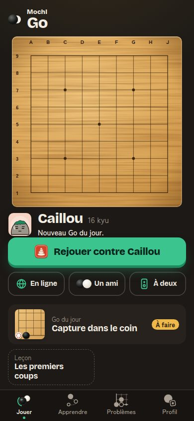 | 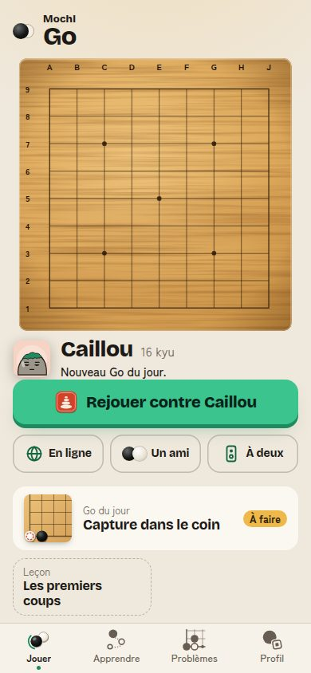 |
| **02.** Jouer : un goban, un bouton en relief, trois modes au trait. Déjà bon. | **02 clair.** Même écran en clair. |
| 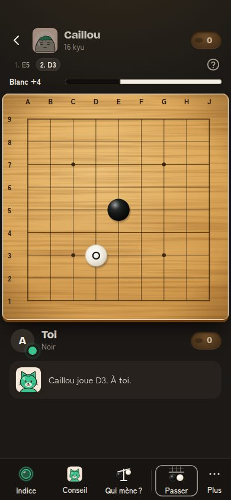 | 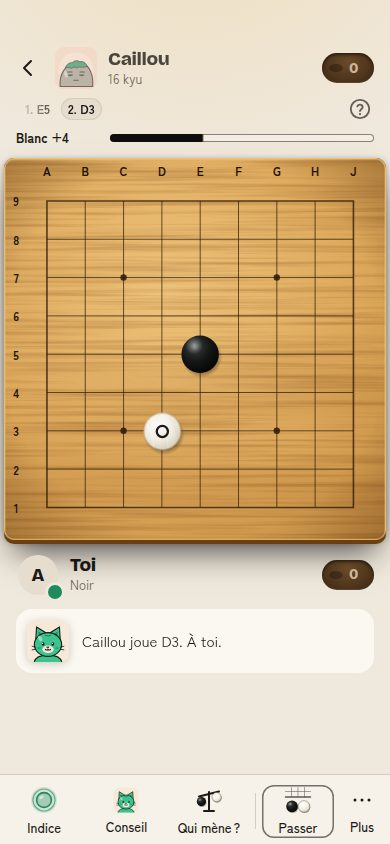 |
| **04.** Partie : la barre d'actions (constat 1). | **04 clair.** Ombre du goban en clair (constat 6). |
| 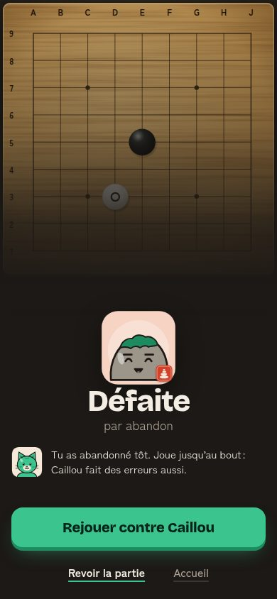 | 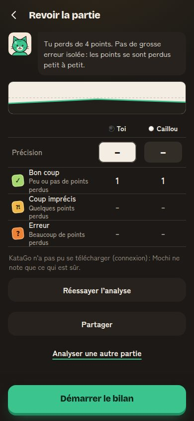 |
| **05.** Fin : moment orchestré, déjà bon. | **06.** Revue : deux boutons pleine largeur et un lien avant l'action (constat 18). |
| 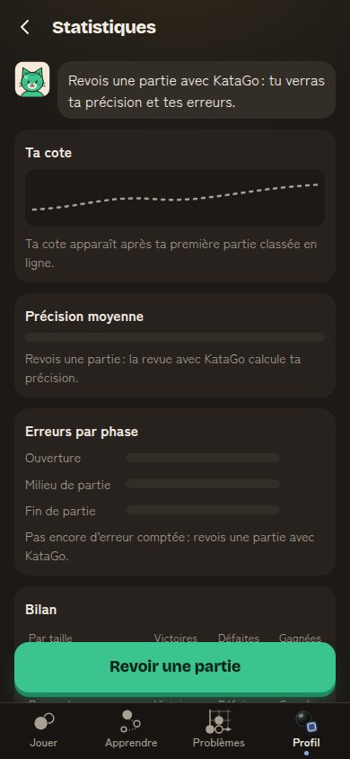 | 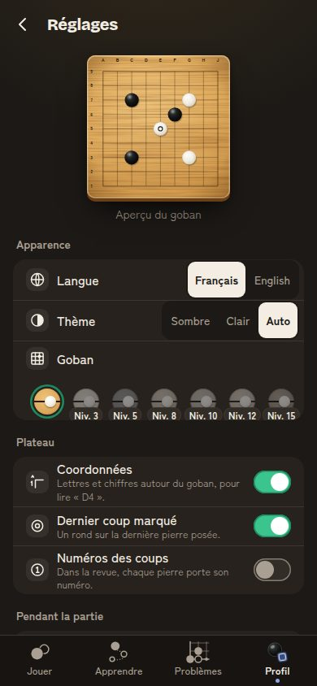 |
| **41.** Statistiques : « Bilan » coupé net derrière le bouton (constat 4). | **42.** Réglages : choix et pastilles sans retour (constat 2). |
| 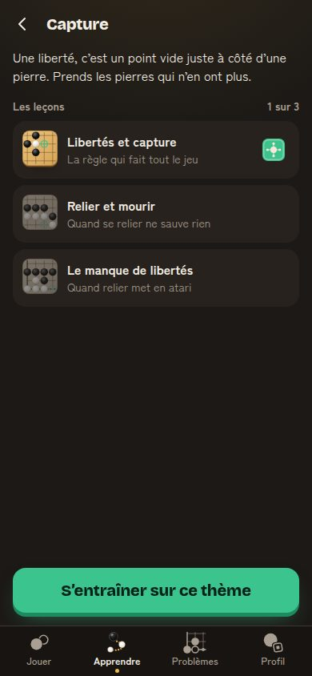 | 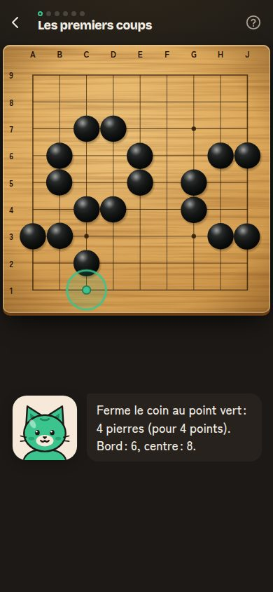 |
| **11.** Thème : 300 px de vide (constat 5). | **12.** Leçon (hors périmètre, partagée avec l'intro). |
| 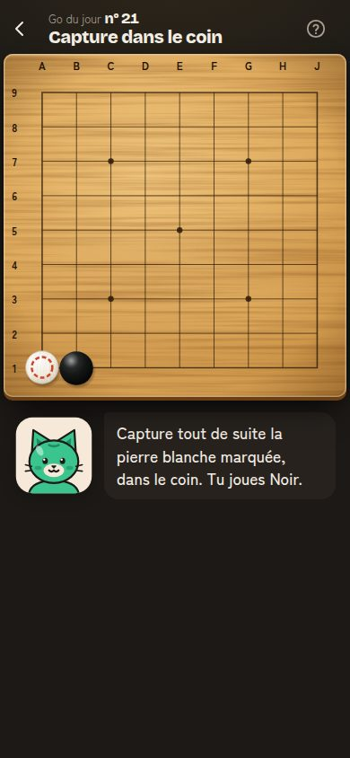 | 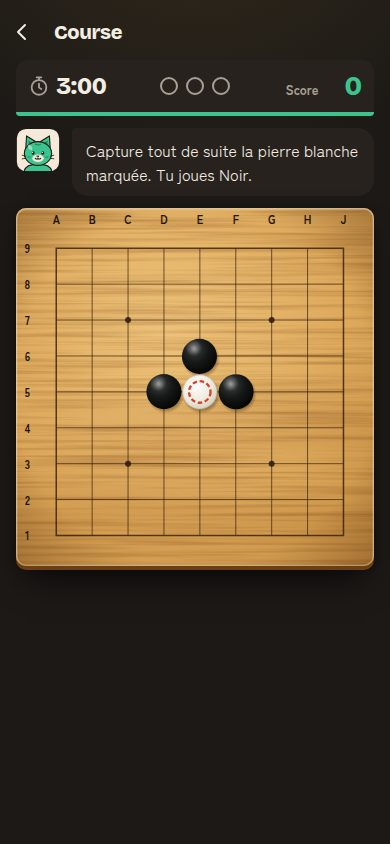 |
| **22.** Problème : 300 px de vide (constat 5). | **24.** Course : goban de 358 px, 280 px de vide (constats 5 et 10). |
| 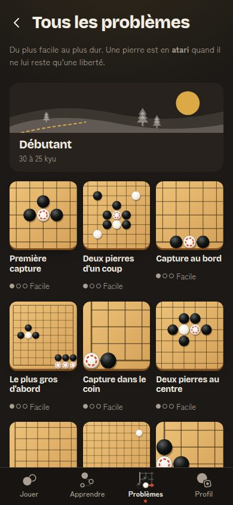 | 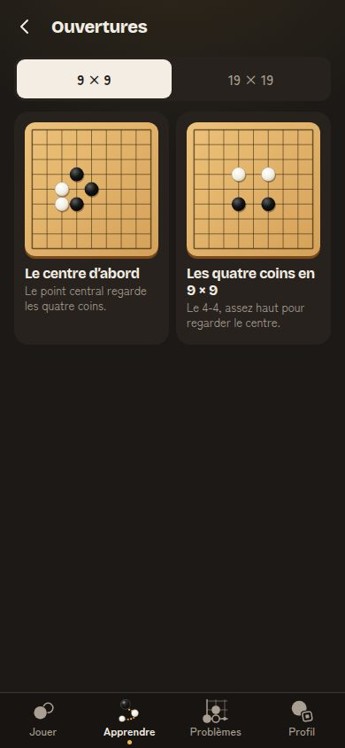 |
| **25.** Titre en 32 px (constat 9). | **13.** Ouvertures : deux cartes, 400 px de vide (constat 5). |
| 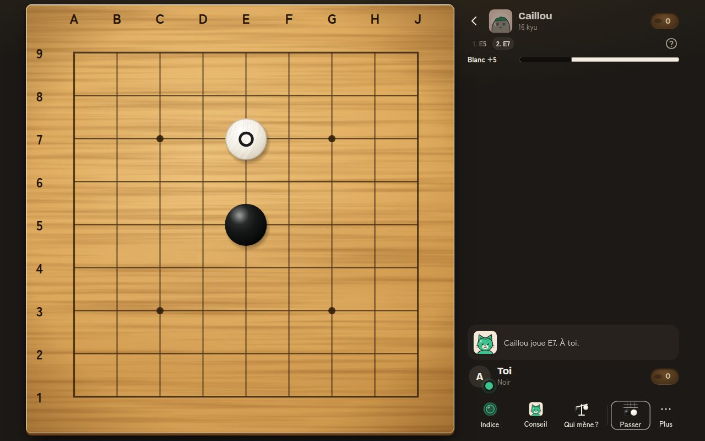 | 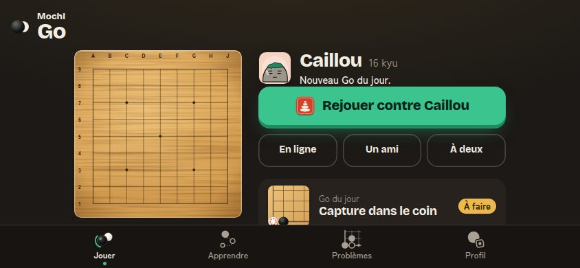 |
| **04 à 1280.** Deux zones, goban à la hauteur de l'écran : déjà bon. | **02 à 844 × 390.** Jouer en paysage : déjà bon. |
| 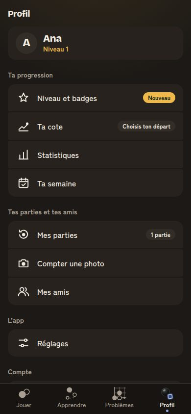 | 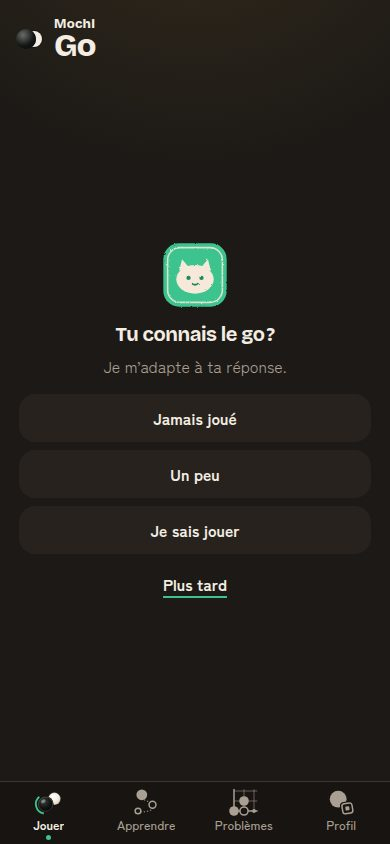 |
| **40.** Profil en sommaire : déjà bon. | **90.** Premier lancement : trois choix de même poids, déjà bon. |
| 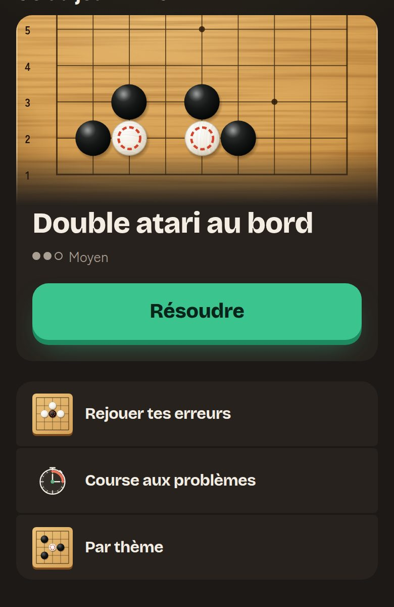 | 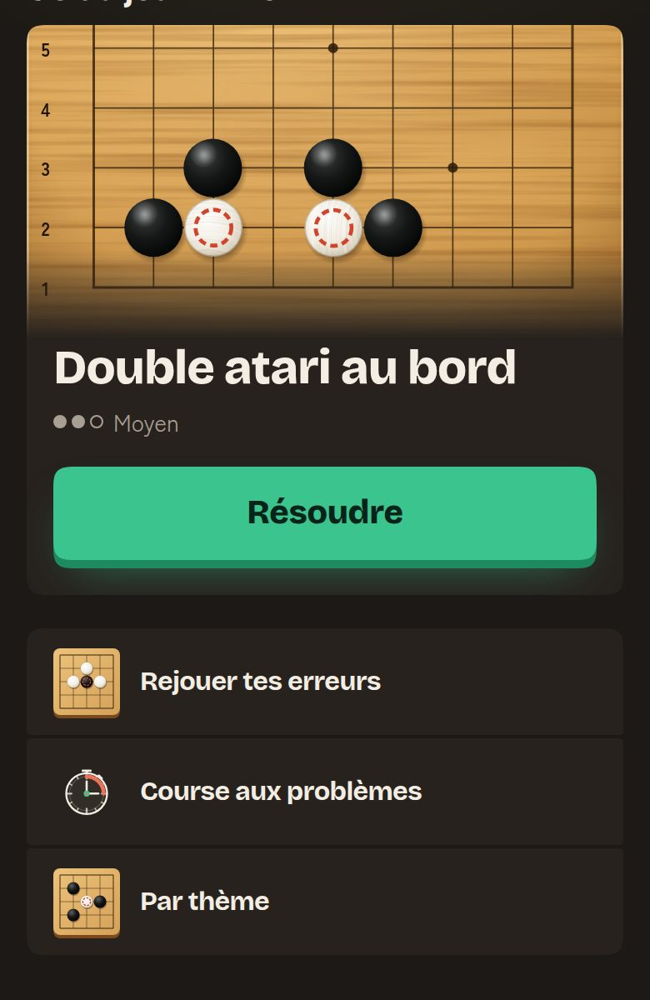 |
| **Essai.** Rayons actuels. | **Essai rejeté.** `corner-shape: squircle` à rayon égal : angles plus secs. |

## 9. Vérifications de ce livrable

- Aucun code de l'app modifié. Fichiers ajoutés : ce document, 20 captures `.jpg` (qualité 82), `e2e/passe-apple-captures.spec.ts` (ignoré sans `APPLE`).
- Les mesures d'appui et de typographie ont été faites avec deux scripts jetables, non commités : leurs résultats sont dans les tableaux ci-dessus.

## 10. Suivi du lot (b) (#722)

- **Correction du constat 2.** Sur les 17 éléments sans retour (hors « Ko » et « Mon compte », déjà écartés : sous la barre du bas), 1 est un faux positif de plus (« Confirmer au doigt », même cause), 6 sont les pastilles de style du goban **verrouillées** (sans retour voulu : elles n'agissent pas) et 2 sont des choix déjà actifs. Il restait **8 vrais manques**, tous corrigés : les 5 boutons de la barre d'actions de la partie et les 3 choix `.seg` pas encore actifs. Re-mesure : 11 éléments sans retour, tous dans les cas ci-dessus (ou sous la barre du bas).
- Valeurs finales : appui en `--duree-rapide` (100 ms), retour en `--duree-pose` (160 ms) ; fondu d'entrée des écrans de 160 ms, opacité de .35 à 1 (pas de 0 : un écran qui arrive ne part jamais du vide, et le plus grand élément visible reste un candidat de rendu) ; bord de défilement de `nav + 56 px + relief + 42 px` de haut (`.cta`) ou `nav + 124 px + relief + 42 px` (`.dock`).
