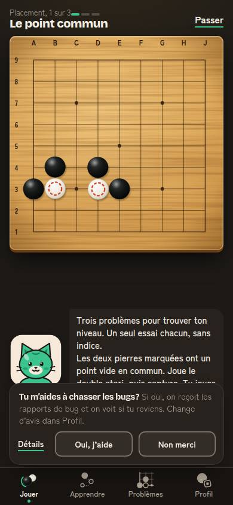
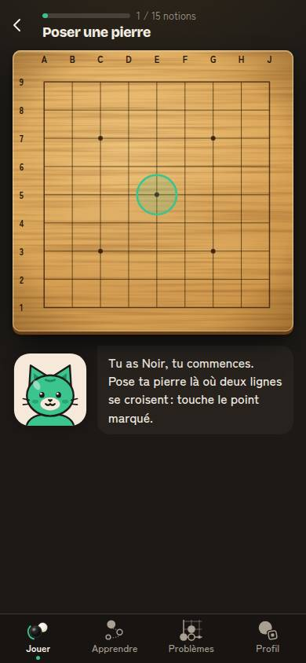

# Architecture des pages : 17 octobre 2026 (#601)

Auteur : agent `ux-jeux-mobiles`. Demande de Florian : « une architecture de pages logiques et qui restent simples pour les users », en même temps que le nettoyage de l'interface (épure #592, Hick #571).

Cet audit ne change aucun code. Il dresse l'inventaire réel des écrans, liste les problèmes, propose une carte cible et un plan en petits lots. Les règles vérifiables sont dans `DESIGN.md`, section « Architecture » (A1 à A12).

## 1. Méthode

- **Code lu** : `src/app/App.tsx` (aiguillage de tous les écrans, l. 847 à 1096), `src/app/ecrans.ts`, `src/ui/IconesNav.tsx`, `src/app/modes.ts`, `src/app/connaitGo.ts`, et chaque écran de `src/app` (Accueil, Learn, Lecon, ThemeLecons, Ouvertures, Puzzles, CourseProblemes, Profil et ses sous-vues, Direct, Lentes, Defis, PartiePartagee, Placement, PartieDecouverte, IntroRegles, SeanceRevisions, Revue, RejouerErreurs, MesParties, CreerCompte).
- **App explorée** : `main` à `bceb8fd`, build de test (`VITE_E2E=1`), `vite preview` sur le port 4404, Chromium de `/opt/pw-browsers`, 390 × 844, tactile, `fr-FR`, mouvements réduits, sombre et clair. Joueur habitué sans compte (3 parties, Pomme battue). Script jetable : il touche les onglets et les écrans, relève l'onglet actif (`aria-current`), le titre du document, l'adresse et `history.length`, puis essaie le retour du navigateur.
- **Ce que l'exploration confirme** :
  - `history.length` reste à 2 du début à la fin : aucun écran n'ajoute d'entrée d'historique. L'adresse ne change jamais (`/`).
  - Partie guidée lancée depuis Apprendre : plein écran, titre « Partie guidée », puis retour sur Apprendre.
  - Leçon ouverte, puis Problèmes, puis Apprendre : la leçon est fermée, on retombe sur le chemin.
  - Profil › Réglages, puis Jouer, puis Profil : on retombe sur le menu du Profil.
  - Problème ouvert, puis Profil, puis Problèmes : le problème est fermé.
  - Placement ouvert depuis le Profil : l'onglet actif passe à **Jouer**.
  - Partie de découverte ouverte depuis Jouer : la barre du bas reste, l'onglet Jouer est actif.
- **Captures** (`docs/ux/captures/architecture/`, JPEG, 390 × 844, sombre et clair) :
  - `01-jouer-*` : accueil d'un habitué ;
  - `02-apprendre-*` : trois portes avant la première leçon (règles, découverte, guidée) ;
  - `08-placement-depuis-profil-*` : l'onglet Jouer s'allume alors qu'on vient du Profil ;
  - `10-decouverte-depuis-jouer-*` : une activité plein cadre, mais avec la barre du bas ;
  - `11-lecon-*` : la leçon, avec la barre du bas ;
  - `14-profil-*` : le menu du Profil.

 

## 2. Avant : l'arbre réel des écrans

Profondeur entre crochets : nombre de touchers depuis la racine de l'onglet. `→ X` : l'écran s'ouvre dans un autre onglet que celui où l'on était. `▣` : plein écran, sans barre du bas. `▤` : barre du bas visible.

```
JOUER (accueil)                                                    [0]
├─ « Tu connais le go ? » (au tout premier lancement, à la place)   [0]
│  └─ Introduction des règles ▤ ─┬─ Partie de découverte ▤           [2]
│                                └─ Partie contre Pomme ▣            [2]
├─ feuille « Changer » (adversaire, taille, réglages repliés)       [1]
├─ Jouer en ligne · En direct ▤ (bouton principal, avec un compte)  [1]
│  ├─ bascule « Partie lente » ▤ (choix, recherche, liste)          [2]
│  │  └─ partie lente ▣ (écran du défi)                             [3]
│  ├─ attente ▤                                                     [2]
│  │  └─ partie contre l'IA en attendant + bande « je cherche » ▣   [3]
│  └─ partie en direct ▣ → bilan ▣ → revue ▣                        [3-5]
│     └─ nom de l'adversaire → Profil de X  (→ PROFIL)
├─ Partie contre l'ordi ▣ (bouton, plateau ou tuile « L'ordi »)     [1]
│  └─ fin ▣ ─┬─ Revoir ma partie ▣ → Rejouer mes erreurs ▣          [2-3]
│            ├─ Rejouer
│            └─ « Ouvrir la leçon »  (→ APPRENDRE, leçon)
├─ Un ami : Défier un ami ▤ (liste, lien)                           [1]
│  └─ partie du défi ▣ → bilan → revue                              [2-4]
├─ À deux ▣ (tuile, ou « Plus » avec un compte)                     [1-2]
├─ Découverte ▤ (tuile, ou « Plus » avec un compte)                 [1-2]
│  └─ fin  (→ APPRENDRE, même lancée depuis Jouer)
├─ feuille « Plus » (À deux, Découverte)                            [1]
├─ « Je sais déjà jouer » : Placement ▤                             [1]
│  └─ fin ─┬─ Jouer contre X ▣
│          └─ Leçons conseillées  (→ APPRENDRE)
├─ Reprendre ta partie ▣                                            [1]
├─ À toi de jouer (parties lentes, défis) ▣                         [1]
├─ Aujourd'hui : Go du jour  (→ PROBLÈMES, problème ouvert)         [1]
│               Leçon n sur 48  (→ APPRENDRE, leçon ouverte)        [1]
├─ Révisions du jour (N) : séance ▤                                 [1]
├─ carte « Ta semaine passée » (1 fois par semaine)
│  └─ Profil de X  (→ PROFIL)
├─ lien de défi reçu : arrivée ▤                                    [0]
└─ lien de partie reçu : Partie partagée ▤                          [0]
   └─ « Étudie-la »  (→ PROFIL, Étudier une position)

APPRENDRE (chemin)                                                 [0]
├─ Revoir les règles : Introduction des règles ▤                    [1]
├─ Partie de découverte ▤                                           [1]
├─ Partie guidée ▣  (onglet interne Jouer ; sortie → APPRENDRE)     [1]
├─ Leçon ▤ (Commencer, ou une pierre du chemin)                     [1]
│  └─ fin ─┬─ 3 problèmes du thème ▤                                [2]
│          ├─ Leçon suivante ▤
│          └─ Jouer contre Pomme ▣  (→ JOUER)
├─ Par thème : page du thème ▤                                      [1]
│  ├─ Leçon ▤                                                       [2]
│  └─ Série de problèmes du thème ▤                                 [2]
└─ Ouvertures ▤ (dans le chapitre « L'ouverture »)                  [1]
   └─ une ouverture ▤                                               [2]

PROBLÈMES (liste)                                                  [0]
├─ Go du jour : problème ▤                                          [1]
├─ Tes erreurs à rejouer (section) → problème ▤                     [1]
├─ Révision du jour (section) → problème ▤                          [1]
├─ Problème suivant ▤                                               [1]
├─ Course : consigne → course → fin ▤                               [1-3]
├─ Par thème : série du thème ▤                                     [1]
├─ Tous les problèmes : grille ▤ → problème ▤                       [1-2]
└─ « Crée ton compte » (lien)  (→ PROFIL, menu)

PROFIL (« Ton parcours »)                                          [0]
├─ feuilles : Partager, Aide, Nous écrire                           [1]
├─ Mes parties ▤                                                    [1]
│  ├─ une partie : revue ▤ → Rejouer mes erreurs ▣                  [2-3]
│  ├─ Analyser une partie (import SGF) ▤                            [2]
│  └─ Étudier une position ▤                                        [2]
├─ Mes amis ▤                                                       [1]
│  └─ Profil de X ▤ → Profil de Y ▤ → … (pile sans fond)            [2-n]
│     └─ Défier  (→ JOUER, partie du défi)
├─ Ta cote ▤ / Titre du mois ▤                                      [1]
├─ Faire le placement  (→ JOUER, Placement)                         [1]
├─ Ta semaine ▤                                                     [1]
│  ├─ « Joue une partie »  (→ JOUER, partie lancée)
│  ├─ « Fais des problèmes »  (→ PROBLÈMES)
│  └─ Profil de X ▤                                                 [2]
├─ Statistiques ▤ → « Revoir » (→ Mes parties)                      [1-2]
├─ Rappel ▤, Installer l'app ▤, Réglages ▤                          [1]
├─ Mon compte ▤ → Mes données ▤ → Mentions légales ▤                [1-3]
└─ Conditions et confidentialité ▤ → Mes données / Mentions ▤       [1-2]

PAR-DESSUS TOUT
├─ Crée ton compte ▣ (garde de l'essai, depuis 10 endroits) ; Choisis ton pseudo ▣ ; Accord aux conditions ▣
│  └─ « Conditions »  (→ PROFIL)
├─ Aide ▤ (feuille ; « ? » ou touche « ? ») → une leçon (→ APPRENDRE) ou les règles
├─ Consentement (bandeau), Repli hors ligne (feuille), fête de niveau, fête de titre, nouvelle version
```

## 3. Inventaire

Colonnes : **Chemins** (et profondeur) ; **Sortie** (et si elle est prévisible) ; **Onglet actif** pendant l'écran ; **Remarques** (doublon, impasse, changement d'onglet). Les écrans de compte et les fêtes sont groupés à la fin.

| # | Écran | Chemins (profondeur) | Sortie | Onglet actif | Remarques |
|---|---|---|---|---|---|
| 1 | Accueil Jouer | barre du bas (0) | onglet | Jouer | Racine. 3 tuiles de modes, tuiles du jour, cartes. |
| 2 | « Tu connais le go ? » | premier lancement, à la place de l'accueil (0) | une réponse ; pas de retour | Jouer | Normal : écran unique de choix. |
| 3 | Introduction des règles | réponse à « Tu connais le go ? » (1) ; Apprendre › Revoir les règles (1) ; Aide › Revoir les règles en jouant (2) | « ‹ » vers l'origine : prévisible. Fin : Découverte ou partie contre Pomme. | celui d'origine | Activité **avec** barre du bas : toucher un onglet l'abandonne sans rien dire. |
| 4 | Feuille « Changer » | Accueil › Changer (1) | voile, croix, Échap | Jouer | Bien. |
| 5 | Feuille « Plus » | Accueil › Plus (1), avec un compte seulement | voile, croix | Jouer | Contient À deux et Découverte. Son sous-titre et son nom accessible disent encore « À deux, **guidée**, découverte » (`mode.plus.detail`, `mode.plus.aria`) : la guidée est partie dans Apprendre (#589). |
| 6 | Partie contre l'ordi | bouton, plateau, tuile « L'ordi » (1) ; Reprendre (1) ; fin de leçon (Apprendre, 2) ; fin du placement (2) ; fin de l'introduction (2) ; Mes parties vide (Profil, 2) ; Ta semaine (Profil, 2) ; Partie partagée (1) ; repli du direct (3) | « ‹ » avec confirmation → **toujours** l'accueil Jouer | aucun (plein écran) ; onglet interne Jouer | Lancée depuis Apprendre ou le Profil, la sortie ne ramène pas d'où l'on vient. |
| 7 | Fin de partie | dans la partie | Accueil, Rejouer, Revoir ; « Ouvrir la leçon » | aucun | « Ouvrir la leçon » change d'onglet (→ Apprendre). |
| 8 | Revue d'une partie | Fin › Revoir ma partie (2) ; Mes parties › une partie (Profil, 2) ; bilan du direct ou du défi (4) | « ‹ » vers la fin ou la liste : prévisible | aucun ou Profil | Trois portes, un seul écran (`Revue.tsx`) : bien. « Revoir ma partie » / « Revoir la partie » : deux noms. |
| 9 | Rejouer mes erreurs | Revue › bouton (3) | « ‹ » vers la revue | aucun | Profondeur 3 depuis le Profil, mais c'est une activité. |
| 10 | Partie à deux | tuile (1) ou Plus › À deux (2) | « ‹ » → accueil | aucun | Bien. |
| 11 | Partie guidée | Apprendre › Partie guidée (1) | « ‹ » → Apprendre (#589) ; fin → Apprendre | aucun ; **onglet interne Jouer** | Invisible pour le joueur (plein écran), mais Apprendre est remonté à neuf au retour : le défilement est perdu. |
| 12 | Partie de découverte | tuile Découverte (1) ou Plus (2) ; Apprendre (1) ; fin de l'introduction (2) | « ‹ » vers l'origine ; **fin → Apprendre** même lancée depuis Jouer ; fin après l'introduction → Jouer | celui d'origine | **Trois portes.** Activité avec barre du bas. Lancée depuis Jouer, elle finit dans Apprendre. |
| 13 | Placement | Accueil › Je sais déjà jouer (1) ; Profil › Faire le placement (1) | **« Passer » seulement** : il note le placement comme sauté (s'il n'a jamais été fait) et ramène à Jouer | **Jouer, même depuis le Profil** | Impasse douce : pas de « plus tard ». Depuis le Profil, l'onglet change sous le joueur et la sortie le laisse dans Jouer. Fin : « Leçons conseillées » (→ Apprendre). |
| 14 | En ligne, En direct (choix, attente) | bouton principal (1) ; attente (2) | « ‹ » → accueil : prévisible | Jouer | Bien (#465, #571). |
| 15 | Partie en direct, bilan, revue | attente (3) ; repli rejoint (4) | bilan → Rejouer, Accueil | aucun | Nom de l'adversaire → Profil de X : **change d'onglet** (→ Profil) ; « Retour » ramène au menu du Profil, plus à la partie. |
| 16 | En ligne, Partie lente (choix, recherche, liste) | bouton principal si mémorisé (1) ; bascule (2) ; tuile « À toi de jouer » (1) | « ‹ » → accueil | Jouer | Bien. |
| 17 | Partie d'un défi ou partie lente | Un ami › défi (2) ; tuile du jour (1) ; liste lente (3) ; Profil › Mes amis › Défier (2) ; Profil de X › Défier (3) | « ‹ » → accueil Jouer, ou liste lente | aucun ; onglet interne Jouer | Depuis le Profil : **change d'onglet**, la sortie ne ramène pas au Profil. |
| 18 | Défier un ami (liste) | tuile « Un ami » (1) | « ‹ » → accueil | Jouer | Les défis vivent dans Jouer, les amis dans le Profil : deux maisons voisines. |
| 19 | Arrivée par un lien de défi | lien (0) | « Retour à l'accueil » | Jouer | Bien. |
| 20 | Partie partagée | lien (0) | « ‹ » → accueil | Jouer | « Étudie-la » → Profil › Étudier une position (**change d'onglet**) ; « ‹ » de l'étude → Mes parties, pas la partie partagée. |
| 21 | Révisions du jour (séance) | tuile de l'accueil (1) | fin → accueil | Jouer | **Doublon** avec Problèmes › Révision du jour et Tes erreurs à rejouer. Noms presque identiques. Activité avec barre du bas. |
| 22 | Carte « Ta semaine passée » | accueil, une fois par semaine | Fermer | Jouer | Pseudo d'un ami → Profil de X (**change d'onglet**). |
| 23 | Chemin des leçons | barre du bas (0) | onglet | Apprendre | Avant « Commencer » : Revoir les règles, Partie de découverte, Partie guidée (`02-apprendre-*`). |
| 24 | Leçon | Commencer (1) ; tuile « Leçon n » de l'accueil (1, → Apprendre) ; Aide › leçon (2, → Apprendre) ; fin de partie (→ Apprendre) ; fin du placement (→ Apprendre) ; lien du Go du jour pour un nouveau (→ Apprendre) ; page d'un thème (2) | « ‹ » → chemin ou page du thème | Apprendre | **Sept portes**, dont cinq hors d'Apprendre : toutes changent d'onglet, et la sortie ramène au chemin, jamais à l'origine. Activité avec barre du bas : un onglet touché la ferme. |
| 25 | Série de 3 problèmes (fin de leçon) | fin de leçon (2) | fin → chemin ou page du thème | Apprendre | Bien. |
| 26 | Page d'un thème | Apprendre › Par thème (1) | « ‹ » → chemin | Apprendre | « Par thème » existe aussi dans Problèmes, avec un autre contenu (#29). |
| 27 | Ouvertures, puis une ouverture | chapitre « L'ouverture » (1, 2) | « ‹ » → chemin, ou liste | Apprendre | État local de `LearnHome` : perdu dès qu'on change d'onglet. |
| 28 | Liste des problèmes | barre du bas (0) | onglet ; re-toucher l'onglet = retour à la liste | Problèmes | Contient deux sections de révision (`MesErreurs`, `RevisionDuJour`). |
| 29 | Séries par thème (Problèmes) | liste (1) | « ‹ » → liste | Problèmes | Même titre « Par thème » que dans Apprendre. |
| 30 | Problème (Go du jour, suivant, grille, révision) | liste (1) ; grille (2) ; tuile « Go du jour » de l'accueil (1, → Problèmes, ouvert d'office) ; lien ou rappel (0) | « ‹ » → liste | Problèmes | Activité avec barre du bas. Changer d'onglet ferme le problème. |
| 31 | Course aux problèmes | liste (1) : consigne, course, fin | « ‹ » → liste | Problèmes | Changer d'onglet perd la course. |
| 32 | Tous les problèmes | lien (1) | « ‹ » → liste | Problèmes | Bien. |
| 33 | Menu du Profil | barre du bas (0) | onglet | Profil | Titre « Ton parcours » : un troisième nom pour l'onglet Profil. |
| 34 | Mes parties | (1) ; Statistiques › Revoir (2) ; Ta semaine › erreurs (2) | « ‹ » → menu | Profil | Contient « Analyser une partie » et « Étudier une position » (2). |
| 35 | Analyser une partie | Mes parties (2) ; menu de la partie › Analyser (en jeu, → Profil) | « ‹ » → **Mes parties**, même ouverte depuis une partie | Profil | Change d'onglet depuis la partie. |
| 36 | Étudier une position | Mes parties (2) ; Partie partagée › Étudie-la (→ Profil) | « ‹ » → Mes parties | Profil | Sortie imprévisible depuis une partie partagée. |
| 37 | Mes amis | (1) | « ‹ » → menu | Profil | — |
| 38 | Profil de X | Mes amis (2) ; une demande (2) ; Ta semaine (2) ; carte de la semaine (accueil, → Profil) ; fin d'une partie en ligne (→ Profil) | « ‹ » : profil précédent de la pile, puis l'écran d'origine **dans le Profil** | Profil | Pile sans fond (profil d'un ami d'un ami…). Quatre portes, toutes vers le Profil. |
| 39 | Ta cote, Titre du mois | (1) | « ‹ » → menu | Profil | — |
| 40 | Ta semaine | (1) | « ‹ » → menu | Profil | Ses boutons lancent une partie (→ Jouer) ou ouvrent Problèmes. Doublon partiel avec la carte de la semaine de l'accueil. |
| 41 | Statistiques | (1) | « ‹ » → menu | Profil | Titre « Mes statistiques », ligne « Statistiques ». |
| 42 | Rappel, Installer, Réglages | (1) | « ‹ » → menu | Profil | Rappel → Mon compte, Installer : saut latéral, sans retour vers Rappel. |
| 43 | Mon compte → Mes données → Mentions légales | (1, 2, 3) | « ‹ » vers l'écran d'origine | Profil | **Profondeur 3.** |
| 44 | Conditions et confidentialité → Mes données, Mentions | (1, 2) ; `/confidentialite` (0) ; « Conditions » des écrans de compte (→ Profil) | « ‹ » → menu ou Conditions | Profil | Depuis « Crée ton compte », change d'onglet. |
| 45 | Crée ton compte | garde de l'essai, depuis 10 actions | « ‹ » → l'écran d'avant ; compte fait → l'action reprend | aucun | Bien (reprise). Mais le lien « Crée ton compte » de Problèmes ouvre le **menu du Profil**, pas cet écran : même mot, deux destinations. |
| 46 | Choisis ton pseudo, Accord aux conditions | bloquants | une action | aucun | Bien. |
| 47 | Aide (feuille) | « ? » en partie, leçon, problème, Profil ; touche « ? » | croix | inchangé | Une leçon depuis l'aide → Apprendre (raccourci contextuel). |
| 48 | Feuilles Partager, Nous écrire, Partager ta partie, Repli hors ligne, consentement | contexte | croix, voile | inchangé | Bien. |

Sur tous les écrans : **le retour Android ferme l'app installée**, le geste de retour d'iOS (dans Safari) quitte le site, et le retour du navigateur quitte Mochi Go. Aucun écran n'écrit dans l'historique (`history.pushState` n'est appelé nulle part ; seul `replaceState` sert à nettoyer l'adresse).

## 4. Problèmes, classés par gravité

Gravité : **bloquant** (on perd ce qu'on faisait, ou on sort de l'app sans le vouloir), **majeur** (on se perd, on ne revient pas où l'on croit), **moyen** (on hésite, on cherche), **mineur** (nom ou détail).

| # | Gravité | Problème | Preuve | Indicateur (charte) |
|---|---|---|---|---|
| G1 | **Bloquant** | **Le retour du système n'est pas géré.** Sur Android, app installée, le geste ou le bouton retour ferme Mochi Go depuis n'importe quel écran : Réglages, une leçon, une revue. Dans le navigateur, il quitte le site. Sur iOS installé, il n'y a pas de geste de retour du tout. | `history.length` constant à 2 ; aucun `pushState` ni `popstate` dans `src/`. Principe Android : « le bouton Retour dépile l'écran du haut et ramène au précédent » ; seul l'écran de départ fait sortir ([Android, principes de navigation](https://developer.android.com/guide/navigation/principles)). | sessions écourtées, rétention J1 ; à mesurer (lot N1) |
| G2 | **Majeur** | **L'état d'un onglet est perdu dès qu'on en change.** Une leçon, un problème, une course, la partie de découverte, les Ouvertures, une sous-vue du Profil : tout se referme. `go()` remet à zéro près de 20 états d'un coup (`App.tsx`, l. 689 à 696), et `Puzzles` et `LearnHome` sont démontés. | Exploration : leçon, problème et Réglages perdus. iOS garde l'état de chaque onglet ([WWDC24, tab bars](https://developer.apple.com/videos/play/wwdc2024/10147/)) ; Android garde une pile par onglet depuis Navigation 2.4 ([multiple back stacks](https://developer.android.com/guide/navigation/backstack/multi-back-stacks)). | leçons commencées puis finies ; problèmes ouverts puis résolus |
| G3 | **Majeur** | **Des écrans changent d'onglet sous le joueur**, et leur sortie ne ramène pas d'où il vient. 12 chemins : Placement depuis le Profil ; Défier depuis Mes amis ou un profil ; Profil de X depuis une fin de partie en ligne ou la carte de la semaine ; Étudie-la depuis une partie partagée ; Analyser depuis une partie ; Découverte lancée de Jouer qui finit dans Apprendre ; Leçon depuis l'accueil, l'aide, la fin de partie ou le placement ; fin de leçon › Jouer contre Pomme ; Ta semaine › Joue une partie ; Conditions depuis les écrans de compte. | Tableau, colonnes « Onglet actif » et « Sortie » ; capture `08-placement-depuis-profil`. | temps passé à revenir ; taps « onglet » juste après une sortie |
| G4 | **Majeur** | **Les activités n'ont pas la même règle de sortie.** La partie est plein écran et revient à l'accueil Jouer ; la leçon, le problème, la découverte, l'introduction, le placement et la séance gardent la barre du bas : un onglet touché par erreur les abandonne sans confirmation. La partie guidée revient à Apprendre, la découverte à son origine ou à Apprendre, le placement n'a que « Passer », qui l'enregistre comme sauté. | `navigation.md` règles 2 et 3 ; `App.tsx` l. 762 (`enPartie`) ; `Placement.tsx` l. 102. Duolingo (observé) : la leçon prend tout l'écran, une croix en haut à gauche, une confirmation, retour au chemin. | leçons abandonnées ; `placement_saute` |
| G5 | **Moyen** | **Doublons : une même chose a plusieurs maisons.** Partie de découverte (Jouer tuile ou Plus, Apprendre, fin de l'introduction). Révisions (séance « Révisions du jour » dans Jouer ; « Révision du jour » et « Tes erreurs à rejouer » dans Problèmes ; « Rejouer mes erreurs » dans la revue). « Par thème » (Apprendre et Problèmes, deux contenus, un seul titre). Placement (Jouer et Profil). Défis (Jouer › Un ami) et amis (Profil). Série affichée à trois endroits (en-tête de Jouer, palmarès de Problèmes, Profil). | Tableau, lignes 12, 21, 26, 29, 13, 18, 37. | `mode_choisi { decouverte }` par `depuis` ; séances de révision finies |
| G6 | **Moyen** | **Profondeur au-delà de 2.** Mon compte › Mes données › Mentions légales (3) ; Profil de X empilés sans fond ; Jouer › En ligne › Partie lente › partie (3, mais la dernière est l'activité). | Tableau, lignes 38 et 43. | — |
| G7 | **Mineur** | **Noms qui changent pour la même chose.** Profil / « Ton parcours » ; « Révisions du jour » / « Révision du jour » ; « Revoir ma partie » / « Revoir la partie » ; « Contre l'ordi » / « L'ordi » ; « Statistiques » / « Mes statistiques » ; « Je sais déjà jouer » / « Faire le placement » / « Ton niveau de départ » ; « Découverte » / « Partie de découverte ». Le sous-titre de « Plus » cite encore la partie guidée. | `src/content/i18n`. | — |
| G8 | **Mineur** | **Un même lien mène à deux endroits.** « Crée ton compte » ouvre l'écran de compte partout, sauf dans Problèmes, où il ouvre le menu du Profil (`App.tsx`, `onCompte={() => go('profil')}`). | Ligne 45. | `compte_cree { origine }` |

Ce qui va bien et qu'on garde : 4 onglets stables, la barre « ‹ titre » unique (`EnteteEcran`), la reprise de l'action après « Crée ton compte », la revue unique pour toutes les parties, les feuilles qui ne changent pas d'onglet, le re-toucher d'onglet qui ramène à la racine (Apprendre, Problèmes).

## 5. Carte cible

### 5.1 Principes retenus

Les principes suggérés tiennent, avec trois précisions tirées du code :

1. **Quatre onglets, un rôle chacun** :
   - **Jouer** : jouer une partie maintenant, et reprendre celles en cours ;
   - **Apprendre** : comprendre (chemin des leçons, thèmes, ouvertures, partie de découverte, partie guidée) ;
   - **Problèmes** : s'entraîner (Go du jour, suivant, course, séries par thème, révisions) ;
   - **Profil** : soi (progrès, parties passées, amis, réglages, compte).
2. **Une maison par chose, un raccourci contextuel au plus.** Un raccourci n'est pas une maison : il ouvre l'activité par-dessus l'écran courant, sans changer d'onglet (précision 1 : c'est ce qui rend le raccourci acceptable). Les chiffres affichés en résumé dans le Profil (série, leçons, badges) ne sont pas des portes : ils ne comptent pas.
3. **Profondeur 2 au plus** depuis la racine d'un onglet, hors activité.
4. **Une activité prend tout l'écran** (partie, leçon, problème, séance, course, découverte, introduction des règles, placement) : pas de barre du bas, une seule sortie en haut à gauche, qui ramène **là d'où l'on vient** (précision 2 : la barre du bas dans une activité est la cause de la moitié des pertes d'état ; la retirer règle G2 et G4 à la fois pour les activités).
5. **Le retour du système** (Android, geste iOS, navigateur, Échap) fait exactement ce que fait le « ‹ » de l'écran, confirmation comprise. À la racine d'un onglet autre que Jouer, il ramène à Jouer ; à la racine de Jouer, il laisse sortir (règle Android de l'écran de départ).
6. **Chaque onglet garde sa pile** quand on en change. Re-toucher l'onglet actif ramène à sa racine (déjà le cas pour Apprendre et Problèmes ; précision 3 : on l'étend à Jouer et Profil).
7. **Un nom par chose**, le même dans l'onglet, le titre de l'écran, le bouton qui y mène et le titre du document.

### 5.2 Arbre cible

`◆` : activité plein écran (sortie unique, vers l'origine). `↗` : raccourci contextuel, ouvert par-dessus, sans changer d'onglet.

```
JOUER  — jouer une partie                                          [0]
├─ feuille « Changer »                                              [1]
├─ En ligne (En direct | Partie lente, une bascule)                 [1]
│  └─ ◆ partie en direct / partie lente (+ bilan, revue)
├─ Un ami : tes défis, créer un lien                                [1]
│  └─ ◆ partie du défi
├─ ◆ partie contre l'ordi (+ fin, revue, rejouer mes erreurs)
├─ ◆ partie à deux
├─ ◆ placement (« Je sais déjà jouer », nouveaux seulement)
├─ Reprendre / À toi de jouer → ◆ la partie
└─ Aujourd'hui : ↗ Go du jour, ↗ leçon n, ↗ révisions (raccourcis vers une activité)

APPRENDRE  — comprendre                                            [0]
├─ ◆ introduction des règles (« Revoir les règles »)
├─ ◆ partie de découverte
├─ ◆ partie guidée
├─ ◆ leçon (+ fin : 3 problèmes, leçon suivante)
├─ Par thème : page du thème                                        [1]
│  └─ ◆ leçon, ↗ s'entraîner sur ce thème (série de Problèmes)
└─ Ouvertures                                                       [1]
   └─ une ouverture                                                 [2]

PROBLÈMES  — s'entraîner                                           [0]
├─ ◆ Go du jour, ◆ problème suivant
├─ ◆ Révisions (un seul nom : séance du jour, erreurs de partie et problèmes ratés)
├─ ◆ course
├─ Séries par thème → ◆ série                                       [1]
└─ Tous les problèmes                                               [1]
   └─ ◆ problème

PROFIL  — toi                                                      [0]
├─ Mes parties                                                      [1]
│  ├─ ◆ revue d'une partie
│  ├─ Analyser une partie                                           [2]
│  └─ Étudier une position                                          [2]
├─ Mes amis                                                         [1]
│  └─ Profil de X (un seul niveau : un autre profil remplace)       [2]
│     └─ ◆ partie du défi (sortie → Profil de X)
├─ Ta cote (et le placement, refaire)                               [1]
├─ Ta semaine                                                       [1]
├─ Statistiques                                                     [1]
├─ Réglages (dont Rappel)                                           [1]
├─ Mon compte                                                       [1]
│  └─ Mes données                                                   [2]
└─ Conditions et confidentialité (Mentions légales en bas de page)  [1]

PAR-DESSUS (feuilles, ne changent pas d'onglet)
├─ Profil de X ouvert hors du Profil (fin de partie en ligne, carte de la semaine) : feuille
├─ Aide, Partager, Nous écrire, Crée ton compte, consentement, repli hors ligne
```

### 5.3 Une maison pour chaque chose

| Chose | Maison | Raccourci gardé (un au plus) | Retiré |
|---|---|---|---|
| Partie de découverte | Apprendre | fin de l'introduction des règles (c'est sa suite) | tuile « Découverte » et « Plus » de Jouer (décision F1) |
| Partie guidée | Apprendre (#589) | — | — |
| Révisions | Problèmes, « Révisions » | tuile « Révisions » d'Aujourd'hui | séance séparée dans Jouer, deux sections distinctes dans Problèmes (décision F2) |
| Séries par thème | Problèmes | « S'entraîner sur ce thème » sur la page du thème d'Apprendre | la série embarquée dans la page du thème |
| Placement | Jouer (nouveaux) | Profil › Ta cote › Refaire | ligne « Faire le placement » du Profil, fusionnée dans « Ta cote » |
| Défis | Jouer › Un ami | « Défier » sur Profil de X | — |
| Amis | Profil › Mes amis | — | — |
| Profil de X | Profil › Mes amis | feuille depuis la fin de partie en ligne et la carte de la semaine | le saut vers l'onglet Profil |
| Série (flamme) | Problèmes, au Go du jour | en-tête de Jouer | palmarès en bas de Problèmes (l'épure le masque déjà à zéro) |
| Objectifs de la semaine | Profil › Ta semaine | carte de l'accueil, une fois par semaine | — |
| Badges, niveau | Profil | — | — |
| Réglages | Profil › Réglages | interrupteurs du menu de la partie (son, aide) | ligne « Rappel » séparée (dans Réglages) |
| Analyser, Étudier | Profil › Mes parties | « Étudie-la » de la partie partagée (◆, sortie vers la partie partagée) | — |
| Leçon | Apprendre | tuile « Leçon n » d'Aujourd'hui, fin de partie, aide (◆ par-dessus, sortie vers l'origine) | — |
| Go du jour | Problèmes | tuile d'Aujourd'hui | — |

### 5.4 Noms

| Pour | Le seul mot | Remplace |
|---|---|---|
| L'onglet et l'écran du Profil | Profil | « Ton parcours » (titre) |
| La révision espacée | Révisions | « Révisions du jour », « Révision du jour », « Tes erreurs à rejouer » (devient un filtre) |
| Revoir une partie finie | Revoir la partie | « Revoir ma partie » |
| Jouer contre l'IA | L'ordi (tuile) ; « Jouer contre Pomme » (bouton) | « Contre l'ordi » |
| Statistiques | Statistiques | « Mes statistiques » |
| Le placement | Ton niveau de départ (écran) ; « Je sais déjà jouer » (lien de l'accueil, c'est la réponse du joueur) | « Faire le placement », « Placement » |
| La partie de découverte | Partie de découverte | « Découverte » |

## 6. Comparaison avec deux jeux de référence

- **Duolingo** (observé, app iOS et Android ; à revérifier à chaque version) : une leçon prend tout l'écran ; pas de barre d'onglets ; une croix en haut à gauche ouvre « Tu vas perdre ta progression dans cette leçon », puis ramène au chemin. Le retour Android fait la même chose que la croix. Chaque onglet (chemin, ligues, profil) garde sa place quand on revient. C'est le modèle pour A4, A5, A6.
- **chess.com** (observé, app) : la partie est plein écran, sans barre (déjà notre règle, `navigation.md`). *Hypothèse à vérifier sur l'app* : un profil ouvert depuis la fin d'une partie s'empile au-dessus du bilan, et le retour y ramène, sans passer par l'onglet de profil. C'est le comportement visé pour la feuille « Profil de X » (N4), quel que soit le résultat de la vérification.
- **Plateforme** (prouvé, documentation) : Android exige que Retour dépile l'écran du haut et ne fasse sortir qu'à l'écran de départ ([principes de navigation](https://developer.android.com/guide/navigation/principles)) et garde une pile par onglet ([multiple back stacks](https://developer.android.com/guide/navigation/backstack/multi-back-stacks)). Apple garde l'état de chaque onglet ([WWDC24, « Elevate your tab and sidebar experience »](https://developer.apple.com/videos/play/wwdc2024/10147/)).

## 7. Plan de migration

Lots petits et indépendants. Chacun part de `main`, a son issue, sa branche, sa PR. Les tailles : XS (moins d'une demi-journée), S (une journée), M (deux à trois jours), L (une semaine).

| Lot | Contenu | Écrans touchés | Risque | Tests e2e à mettre à jour | Gain pour le joueur | Taille | Dépend de |
|---|---|---|---|---|---|---|---|
| **N0** | **Modèle de navigation, sans rien changer à l'écran.** Un module pur `src/app/navigation.ts` : type `Ecran` (union de tous les écrans), une pile par onglet, `ouvrir`, `retour`, `changerOnglet`, `racine`. Tests Vitest. App.tsx le lit en parallèle des états actuels, sans les remplacer. | aucun visible | faible | aucun ; nouveaux tests Vitest | aucun direct : il rend N1 à N3 petits | S | — |
| **N1** | **Retour du système.** Chaque écran au-dessus d'une racine ajoute une entrée d'historique (`pushState`) ; `popstate` appelle la sortie de l'écran (confirmation de quitter une partie comprise) ; feuilles et Aide se ferment au retour. À la racine d'Apprendre, Problèmes ou Profil : retour à Jouer. Événement `retour_systeme { ecran }`. | tous les écrans à sortie (≈ 30), les feuilles | moyen : double retour, boucle, retour pendant une partie en ligne | nouveau `e2e/retour-systeme.spec.ts` (`page.goBack()` sur Réglages, leçon, problème, partie avec confirmation, feuille « Changer », Aide, partie en direct) ; `navigation.spec.ts` ; `robustesse.spec.ts` | le retour Android ne ferme plus l'app ; Safari et navigateur reviennent en arrière au lieu de quitter | M | N0 conseillé |
| **N2** | **Activités plein écran, sortie vers l'origine.** Leçon, problème, série, course, séance, découverte, introduction des règles, placement : sans barre du bas, sortie en haut à gauche. La sortie ramène à l'écran d'origine (pile), pas à une racine fixe. Placement : « ‹ » (plus tard, rien d'enregistré) en plus de « Passer ». | Lecon, Puzzles (lecteur, course), SeriePratique, SeanceRevisions, PartieDecouverte, IntroRegles, Placement ; `docs/ux/navigation.md` (règle 3) | moyen : beaucoup de tests lisent la barre du bas en leçon | `navigation.spec.ts`, `lecon-lecteur.spec.ts`, `lecon-pratique.spec.ts`, `problemes.spec.ts`, `course-problemes.spec.ts`, `decouverte.spec.ts`, `connait-go.spec.ts`, `placement.spec.ts`, `revisions-espacees.spec.ts`, `boutons-non-recouverts.spec.ts`, `petits-ecrans.spec.ts`, `zoom.spec.ts` | plus d'abandon d'une leçon ou d'un problème par un onglet touché ; une seule règle de sortie | M | décision F3 |
| **N3** | **Garder l'état des onglets.** Une pile par onglet (N0) ; `go()` ne remet plus tout à zéro, il change d'onglet ; re-toucher l'onglet actif ramène à sa racine (Jouer et Profil aussi). L'état interne de Problèmes (`openId`, `tous`, `course`) et d'Apprendre (Ouvertures) remonte dans la pile. | App.tsx, Puzzles, Learn, Profil | élevé : `go()` est appelé partout ; les fêtes et l'XP lisent l'écran courant | nouveau `e2e/onglets-etat.spec.ts` ; `recette-*.spec.ts` (R4, re-toucher l'onglet) ; `xp.spec.ts`, `fete-niveau-fin-partie.spec.ts` ; `notifications.spec.ts` | une leçon, un problème ou un réglage retrouvés tels quels après un détour | L | N0 |
| **N4** | **Plus de changement d'onglet sous le joueur.** Profil de X hors du Profil : feuille. Défier depuis un profil : partie ◆, sortie vers le profil. « Étudie-la » : étude ◆, sortie vers la partie partagée. « Analyser » depuis une partie : ◆, sortie vers la partie. Raccourcis vers une leçon (accueil, aide, fin de partie, placement) : leçon ◆ par-dessus, sortie vers l'origine. Fin de leçon › Jouer contre Pomme : sortie vers la fin de leçon. Ta semaine : idem. | App.tsx, ProfilPublic, Amis, PartiePartagee, ImportSgf, Etude, Lecon (fin) | moyen | `profil-public.spec.ts`, `amis.spec.ts`, `emulation-amis.spec.ts`, `partage-etude.spec.ts`, `import-sgf.spec.ts`, `fin-de-partie.spec.ts`, `parcours-debutant-v3.spec.ts`, `aide.spec.ts` | on revient toujours d'où l'on vient | M | N2 |
| **N5a** | **Découverte : une seule maison, Apprendre.** Retirer la tuile et l'entrée de « Plus ». Effet : avec un compte, « Plus » n'a plus que « À deux » ; les trois tuiles (L'ordi, Un ami, À deux) tiennent sans « Plus », la feuille disparaît. | Accueil, `modes.ts`, `mode.plus.*` | faible | `accueil-modes.spec.ts`, `decouverte.spec.ts`, `loi-de-hick.spec.ts`, `a11y-axe.spec.ts` | un choix de moins sur l'accueil, une feuille de moins (Hick) | S | décision F1 |
| **N5b** | **Révisions : une seule maison, Problèmes.** Une entrée « Révisions (N) » en tête de Problèmes ; la séance du jour en est l'activité ; « Tes erreurs à rejouer » et « Révision du jour » s'y fondent. La tuile de l'accueil reste comme raccourci. | Puzzles, SeanceRevisions, MesErreurs, RevisionDuJour, Accueil | moyen : file de révision espacée (#469) | `revisions-espacees.spec.ts`, `revision-du-jour.spec.ts`, `erreurs.spec.ts`, `rejoue-erreur.spec.ts`, `problemes.spec.ts` | une seule chose à comprendre au lieu de trois | M | décision F2 |
| **N5c** | **Par thème : séries dans Problèmes seulement.** La page d'un thème d'Apprendre garde ses leçons et un lien « S'entraîner sur ce thème », qui ouvre la série de Problèmes. | ThemeLecons, SeriesThemes | faible | `apprendre-themes.spec.ts`, `problemes-par-theme.spec.ts` | « Par thème » veut dire une seule chose par onglet | S | — |
| **N6** | **Profondeur 2.** Mentions légales en bas de Conditions (plus d'écran 3) ; Mes données sous Mon compte seulement ; Profil de X sans pile (un profil remplace l'autre) ; Rappel dans Réglages. Placement fondu dans « Ta cote » (refaire). | Profil, Conditions, MesDonnees, MentionsLegales, ProfilPublic, Reglages | faible | `mes-donnees.spec.ts`, `confidentialite.spec.ts`, `profil-public.spec.ts`, `rappel.spec.ts`, `profil.spec.ts`, `placement.spec.ts` | moins de couches dans le Profil, une ligne de moins | S | — |
| **N7** | **Noms constants.** Tableau 5.4 appliqué aux textes fr et en ; sous-titre et nom accessible de « Plus » corrigés tout de suite (bug) ; titre du document aligné (`titreEcran.ts`) ; test Vitest qui vérifie que le titre de chaque écran est le libellé de ce qui y mène. « Crée ton compte » de Problèmes ouvre l'écran de compte. | `src/content/i18n`, `titreEcran.ts`, Puzzles | faible, mais les tests lisent les textes | tous les specs qui cherchent ces libellés (≈ 15, à lister par `grep`) | on reconnaît un écran à son nom | S | — |
| **N8** | **Adresses par écran** (`/apprendre`, `/problemes`, `/profil/reglages`…), optionnel : un rechargement ou un lien rouvre le bon écran ; prépare Capacitor (`App.addListener('backButton')` branché sur la même pile). | App.tsx, `vercel.json`, `public/sw.js` | moyen (service worker, liens existants `/confidentialite`, `#defi=`, `#partie=`) | `url-sensible.spec.ts`, `referencement.spec.ts`, `csp.spec.ts` | liens partageables vers une leçon ; reprise après rechargement | M | N1 |

Ordre conseillé : **N7 (bug de « Plus ») → N0 → N1 → N2 → N4 → N3**, et N5a, N5b, N5c, N6 dès que Florian a tranché, en parallèle. N1 seul règle le problème le plus grave.

### Ce qui concerne la designer (#602, épure d'Apprendre et des écrans de partie et de leçon)

- **N2** change l'en-tête de la leçon et du lecteur de problème (plus de barre du bas, sortie unique en haut à gauche, comme la partie) : à dessiner une fois pour toutes les activités, avec elle. La place rendue (60 px de barre) revient au goban.
- **N5a** et **N5c** allègent le haut d'Apprendre : elle avait déjà proposé de sortir la carte « Partie de découverte » du haut de l'onglet (épure, § 5, proposition 1). La carte cible garde la découverte et la guidée dans Apprendre : à placer dans son chemin.
- **N7** touche les titres d'Apprendre et de la partie (« Revoir la partie », « Partie de découverte ») : à coordonner pour ne pas modifier deux fois les mêmes clés.
- **En-tête** : sa proposition « la marque sur Jouer seulement, le titre de l'écran ailleurs » (épure, § 5, proposition 7) va dans le sens de A9 (un nom par écran). Elle reste dans son périmètre ; N3 et N7 ne touchent pas l'en-tête.
- N2 et N4 ne changent ni la fin de partie ni la barre d'actions de la partie.

## 8. Décisions pour Florian

Chacune a une recommandation ; aucune n'est appliquée sans son accord.

- **F1. Retirer la partie de découverte de Jouer.** Elle reste dans Apprendre et à la fin de l'introduction des règles. Effet : la feuille « Plus » disparaît (les trois tuiles L'ordi, Un ami, À deux tiennent seules). Touche les décisions #429 et #432 (« tous les modes en 1 toucher, ou 2 par Plus ») et #524. Recommandation : **oui**. Contrôle : `mode_choisi { mode: 'decouverte' }` par `depuis` sur 30 jours, et `lecon_commencee` (la découverte ne doit pas disparaître pour les nouveaux : la fin de l'introduction l'ouvre toujours).
- **F2. Fusionner les révisions en une seule « Révisions », dans Problèmes.** Aujourd'hui : une séance dans Jouer, deux sections dans Problèmes, deux noms presque identiques. La tuile de l'accueil reste comme raccourci. Touche #469 et #199. Recommandation : **oui**. Contrôle : séances finies par semaine.
- **F3. Leçon, problème et autres activités en plein écran, sans barre du bas.** Cela inverse la règle 3 de `docs/ux/navigation.md` (#465 : « exercices courts, la barre reste »). Recommandation : **oui**, c'est la seule façon simple d'avoir une sortie unique et de ne plus perdre une leçon par un onglet touché. Contrôle : leçons finies / leçons commencées.
- **F4. Placement fondu dans « Ta cote ».** La ligne « Faire le placement » quitte le menu du Profil ; « Je sais déjà jouer » reste sur l'accueil pour les nouveaux, « Refaire » vit dans « Ta cote ». Touche #283 et #417. Recommandation : **oui**, mais sans urgence (N6). **Fait par #647** : plus de ligne de placement au menu du Profil ; la ligne « Ta cote » (pleine largeur, ou partagée avec le titre du mois) ouvre « Ta cote », où « Ton niveau de départ » (kyu estimé et date) relance le placement. Sans compte, « Ta cote » ne montre que le niveau de départ, et sa ligne au menu dit le kyu estimé.

Ce qui n'est **pas** demandé : supprimer un mode de jeu, une leçon, un problème ou un écran du Profil. Chaque fonction garde un accès, au même nombre de touchers ou à un de plus, sauf la découverte depuis Jouer (F1).

## 9. Contrôles de ce livrable

- Aucune modification de code applicatif : `docs/ux/architecture-pages-2026-10.md`, `docs/ux/captures/architecture/` (12 JPEG, 444 Ko), la section « Architecture » de `DESIGN.md` et quatre entrées de `docs/ux/base-de-connaissances.md` (Boucle de jeu).
- Les règles A1 à A12 de `DESIGN.md` reprennent la carte cible ; chaque lot dit lesquelles il fait passer au vert.

## 10. Suivi : lot N4 (#640)

Mécanisme : `par(maison)` dans `App.tsx` pose l'écran par-dessus l'écran courant (pile `poses`). L'onglet allumé reste celui d'origine (A10), l'écran d'origine reste monté et caché (`.calque[hidden]`), et la sortie le retrouve tel quel, défilement et focus compris (A6). La pile se défait quand l'écran posé revient à la racine de sa maison (« ‹ », fin, retour du système) ; un toucher sur la barre du bas ou un lien la vide. Test : `e2e/sans-changement-onglet.spec.ts`, un test par chemin.

| # | Chemin | Avant | Après |
|---|---|---|---|
| 1 | Profil › placement | Jouer s'allume ; sortie vers Jouer | Profil reste allumé ; « Passer » ou retour : le Profil |
| 2 | Mes amis › Défier | partie dans Jouer ; sortie vers l'accueil | partie plein écran ; « ‹ » : Mes amis |
| 3 | Profil de X › Défier | idem | « ‹ » : le profil de X |
| 4 | fin de partie en ligne › profil de X | bascule dans Profil ; « Retour » : menu du Profil | Jouer reste allumé ; « Retour » : le bilan, intact |
| 5 | carte de la semaine › profil de X | bascule dans Profil | Jouer reste allumé ; retour : l'accueil |
| 6 | partie partagée › Étudie-la | bascule dans Profil ; « ‹ » : Mes parties | Jouer reste allumé ; « ‹ » : la partie partagée |
| 7 | revue d'une partie › Analyser une autre partie | bascule dans Profil ; partie perdue | Jouer reste allumé ; « ‹ » : la revue, intacte |
| 8 | découverte lancée de Jouer | fin dans Apprendre | fin à l'endroit d'origine |
| 9 | leçon depuis l'accueil, l'aide, la fin de partie, le placement, le lien du Go du jour | bascule dans Apprendre ; sortie : le chemin | onglet d'origine allumé ; « Retour » : l'écran d'origine (problème ouvert, écran de fin, bilan du placement) |
| 10 | fin de chapitre › Joue contre Pomme | partie dans Jouer ; sortie : l'accueil | sortie : la fin de leçon |
| 11 | Ta semaine › Jouer une partie | partie dans Jouer ; sortie : l'accueil | sortie : Ta semaine |
| 12 | Crée ton compte (ou accord, consentement) › Conditions | bascule dans Profil ; l'écran de compte est perdu | onglet d'origine allumé ; « ‹ » : l'écran de compte, saisie comprise |

Hors des 12 et laissés tels quels (raccourcis vers Problèmes) : tuile « Go du jour » de l'accueil, Ta semaine › « Faire un problème ». Défier depuis un profil ouvert par-dessus Jouer (chemins 4 et 5) revient à l'accueil de Jouer, pas au profil : deux écrans du même onglet dans une pile demandent N3.

## 11. Suivi : lot N5a (#647)

Décision F1 appliquée. La partie de découverte n'a plus que deux portes : sa maison, Apprendre (« Jouer avec Mochi », fin du chapitre « Les bases », que suit « Revoir les règles »), et la fin de l'introduction des règles (« Jouer avec Mochi » après « Jamais joué », « Partie de découverte avec Mochi » après « Un peu »). Sur Jouer, il reste quatre modes : le bouton et trois tuiles (L'ordi ou En ligne, Un ami, À deux), tous en 1 toucher ; la feuille « Plus » et ses textes ont disparu. Sans comptes, « À deux » est la seule tuile. `mode_choisi { mode: 'decouverte', depuis: 'apprendre' }` est envoyé depuis la carte d'Apprendre, pour le contrôle de F1. Premiers pas inchangés : la question « Tu connais le go ? » mène toujours « Jamais joué » et « Un peu » à l'introduction, dont la fin ouvre la découverte ; « Je sais jouer » garde « Je sais déjà jouer » (placement). Une partie lancée depuis « Jouer avec Mochi » revient sur ce groupe déplié (A6), même s'il s'était ouvert seul (découverte en cours). Captures : `docs/ux/captures/maison-647/`.

## 12. Sommaire puis détail (A13 ; #652, #653, #654)

Retour de Florian, 18/10, captures de chess.com à l'appui : Apprendre, Problèmes et le Profil montrent trop de choses à la fois. Le modèle : une racine qui est un **sommaire** (peu d'entrées, chacune avec son icône), puis un **détail** qui s'ouvre par-dessus avec « ‹ ». Règle A13 de `DESIGN.md`, composant `src/ui/Sommaire.tsx`.

Méthode (skills `information-architecture`, `navigation-patterns`, `hicks-law`, `serial-position-effect`, `jakobs-law`) :
- **Hick** : on compte les choix de même poids au premier regard ; 4 au plus par groupe (E3).
- **Position dans la liste** : l'action principale en premier (primauté) ; la liste longue en dernier (P5), pour que le reste ne se perde pas sous elle.
- **Jakob** : le joueur de go en ligne connaît chess.com ; on reprend sa forme (une ligne = une icône et un nom, sans chevron décoratif) plutôt que d'en inventer une. On n'en reprend pas le « Passez Premium ».
- **Profondeur** : un détail ne contient pas de second sommaire (A4).

### 12.1 Apprendre (#652)

Captures (sombre, 390 × 844) : `captures/sommaires/apprendre-390-avant.jpg`, `apprendre-390-apres.jpg`, et en clair `apprendre-390-clair-apres.jpg`.

| | Avant | Après |
|---|---|---|
| Premier regard (390 × 844) | Chapitre « Les bases » (titre, 7 mini-pierres), 3 pierres du chemin, la carte « Reprendre », le début de « Par thème » | La carte « Reprendre » (seul relief), trois entrées (Ouvertures, Jouer avec Mochi, Revoir les règles), le début de « Par thème » |
| Blocs (E2) | 4, plus 6 chapitres et « Bientôt » en défilant (page de 5 660 px à 390 px) | 3 ; page de 1 800 px |
| Accès à une leçon qui n'est pas la prochaine | sa pierre sur le chemin | la page de son thème (toutes les 48 leçons y sont : `src/app/themesApprendre.test.ts`) |
| Thèmes | 6, puis « Tous les thèmes » | les 15, sans pli |
| Jouer avec Mochi | lien qui déplie deux cartes à la fin des « Bases » | entrée du sommaire, puis un détail avec la découverte et la guidée |

Ordre retenu : carte, entrées, grille. Florian citait la grille avant la liste ; mais la grille de 15 thèmes est la seule liste longue (≈ 1 000 px) : posée avant les trois entrées, elle les pousserait à 1 400 px de haut, sous trois écrans de défilement (P5 et effet de position : le milieu d'une longue page est oublié). Les entrées tiennent en 200 px juste sous la carte.

Pas de pli sur la grille : il cachait 9 thèmes sur 15, donc la moitié des leçons, maintenant que le chemin ne les montre plus. Une colonne d'entrées toutes semblables (visuel, nom, une ligne) se parcourt du regard, dans l'ordre où les leçons font découvrir chaque thème.

Ce qui ne change pas : l'accès aux leçons (#343 : sans compte, « Avec un compte » après la leçon 3, la leçon reste touchable et ouvre la création de compte), écrit dans la page du thème ; la fin de leçon et de chapitre (Lecon.tsx), les badges et l'XP ; la fête de fin de chapitre, qui se joue en tête du sommaire à la première visite qui la mérite (tampon d'or et confettis). Ce qui disparaît : le chemin, les en-têtes de chapitre (et leur tampon permanent), « Bientôt ».
