# Épure des écrans : 17 octobre 2026 (#592)

Auteur : agent designer. Retour de Florian, en se baladant dans l'app : « On met beaucoup d'informations à chaque fois sur les écrans alors que ça pourrait être épuré et bien plus léger, pour que le regard amène là où on souhaite que la personne clique. »

Suite de l'audit « loi de Hick » (`docs/ux/loi-de-hick-2026-10.md`, #571). Hick comptait les **choix** ; cet audit regarde le **bruit** : tout ce qui se lit sans servir l'action (sous-titres, durées, compteurs, pastilles, cartes qui rivalisent avec le bouton).

## 1. Méthode

- **Règles** : celles de la section « Épure » de `DESIGN.md` (E1 à E14, #594). Chaque décision ci-dessous cite la règle qu'elle applique ; la section 3 donne le tableau avant / après par écran. Cet audit ne fixe pas de nouveau seuil.
- **Build** : `main` à `a6c5509`, build de test (`VITE_E2E=1`), Supabase simulé par `e2e/fauxSupabase.ts`, joueuse connectée (Ana, 6 parties, Pomme battue, 3 leçons finies, Caillou en cours). Chromium, 390 × 844, densité 1, `fr-FR`, mouvements réduits, horloge figée au 17/10/2026 à midi.
- **Captures** : `EPURE=docs/ux/captures/epure-avant npx playwright test epure-captures --workers 1` (`e2e/epure-captures.spec.ts`, lancement manuel). PNG allégés en palette de 256 couleurs (40 Ko environ chacun). Le spec Playwright Test plutôt que `playwright-cli` : il branche le faux Supabase (`brancher`) et fige l'horloge, ce qu'il faudrait refaire à la main dans la CLI.
- **Règle de tri**, pour chaque élément : « si on l'enlève, le joueur rate-t-il quelque chose d'important ? »
  - Non : **coupé**.
  - Utile mais pas urgent : **déplacé** plus bas, **replié** derrière un toucher, ou gardé pour le **lecteur d'écran** seulement (nom accessible).
  - Oui : **gardé**, mais en couleur atténuée s'il n'est pas l'action.
- **Ce qu'on ne fait pas** : supprimer une fonction. Chaque accès reste, au même nombre de touchers ou à un de plus.
- **Garde-fous** : le vocabulaire du go reste expliqué la première fois (règle 5), mais au moment où on en a besoin ; le texte atténué reste AA (`--muted` : 6,7:1 sur le fond sumi, 6,0:1 sur `--surface` ; 5,3:1 sur le washi, 6,1:1 sur `--surface` clair ; vérifié par `src/ui/tokens.test.ts`) ; 44 px ; zoom 200 % ; mouvements réduits.

## 2. Audit par écran

Pour chaque écran : l'action voulue, ce que le regard voit en premier, ce qui le détourne, et la décision.

### 2.1 Jouer, tout premier lancement (avant la première pierre)

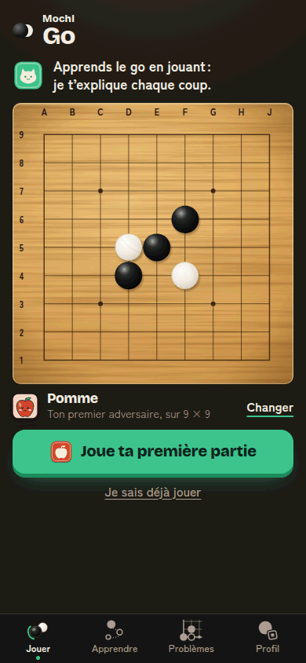

- **Action voulue** : « Joue ta première partie ».
- **Premier regard** : la promesse de Mochi, puis le goban, puis le bouton. Bon ordre : la promesse dit pourquoi, le bouton dit quoi.
- **Détourne** : peu de chose. « Ton premier adversaire, sur 9 × 9 » répète la taille que le goban montre déjà.
- **Décision** : « sur 9 × 9 » **coupé** (E8 : le goban le montre, et la feuille « Changer » le dit). Le reste est déjà épuré (#487) : on n'y touche pas.

### 2.2 Jouer, après la première pierre (aucune partie finie)

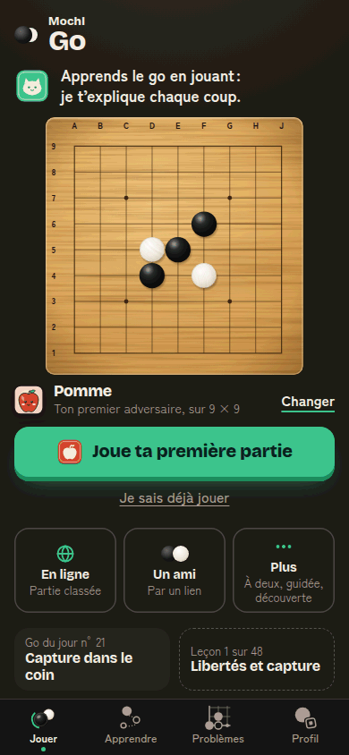

- **Action voulue** : « Joue ta première partie ».
- **Premier regard** : la promesse de Mochi en gras, en haut. Puis le goban, le bouton, et **9 lignes de texte** sous le bouton : trois tuiles de modes à deux lignes chacune (« En ligne / Partie classée », « Un ami / Par un lien », « Plus / À deux, guidée, découverte ») et deux tuiles du jour.
- **Détourne** :
  - la promesse : elle a fait son travail, la première pierre est posée ;
  - les sous-titres des tuiles de modes : le détail de « Plus » (« À deux, guidée, découverte ») se lit dans la feuille qu'il ouvre ; « Partie classée » est une promesse prématurée pour un débutant (P4 de #571) ;
  - les tuiles de modes font 95 px de haut : autant de goban en moins.
- **Décision** :
  - promesse **coupée** après la première pierre (elle reste au tout premier lancement ; E5 : une seule voix, et E2 : 6 blocs → 5) ;
  - sous-titres des tuiles **coupés** (E6) : une ligne par tuile, pictogramme et nom (48 px de haut au lieu de 95). Ce qu'ils disaient reste dans le **nom accessible** (« En ligne : Partie classée, 15ᵉ kyu · 1500 ? », « L'ordi : Jouer contre Caillou ») ;
  - tuiles du jour gardées (elles sont déjà discrètes, en demi-largeur).
- **Proposition pour Florian (non faite)** : tant qu'aucune partie n'est finie, ranger « En ligne » et « Un ami » sous « Plus » (P4 de #571 ; E2 passerait à 4 blocs). Cela touche la décision #429/#432 (tous les modes à 1 toucher) : à trancher par lui.

### 2.3 Jouer, joueur habitué

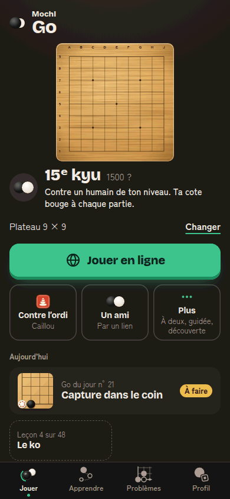

- **Action voulue** : « Jouer en ligne ».
- **Premier regard** : le goban, puis « 15ᵉ kyu » en très grand, puis deux lignes d'explication, puis le bouton.
- **Détourne** :
  - « Contre un humain de ton niveau. Ta cote bouge à chaque partie. » : deux phrases à relire à chaque visite ;
  - les sous-titres des tuiles (« Caillou », « Par un lien », « À deux, guidée, découverte ») ;
  - le titre « Aujourd'hui », au-dessus d'une seule tuile en avant qui porte déjà sa pastille « À faire ».
- **Décision** :
  - la réplique passe à **une phrase** (E5) : « Contre un humain de ton niveau. » (la cote s'explique dans Profil, « Ta cote ») ; sans compte, même phrase (« Ton compte garde ta cote » le dit l'écran « Crée ton compte », qui s'ouvre au toucher) ;
  - sous-titres des tuiles **coupés** (voir 2.2) ; « Contre l'ordi » devient « L'ordi » pour tenir sur une ligne à côté de son sceau ;
  - « Aujourd'hui » **coupé** à l'écran, **gardé** comme nom du groupe pour le lecteur d'écran (E9) ;
  - « Plateau 9 × 9 · Changer » se range sous l'adversaire, dans le même bloc, en `--muted` (E2 : 6 blocs → 5 ; E10) ;
  - le goban gagne les 47 px rendus par les tuiles.
- **Tension laissée à Florian** : le bloc de la partie classée porte deux chiffres, « 15ᵉ kyu » et « 1500 ? », qui disent la même chose à deux échelles (E7, E8). #432 a voulu « cote et grade visibles » : proposition, garder le grade seul à l'écran et la cote dans le nom accessible et dans Profil.
- **Gardé** : la pastille « À faire » (un état, pas un texte), le numéro du Go du jour (c'est ce qu'on partage), « Leçon 4 sur 48 » (progression).
- **Après** (lot A) : 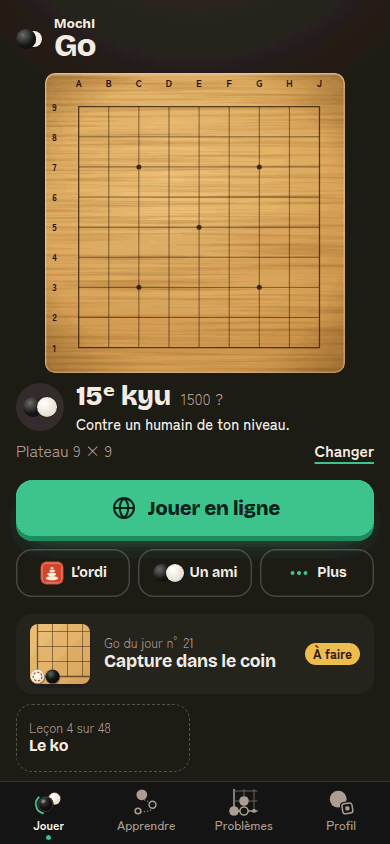 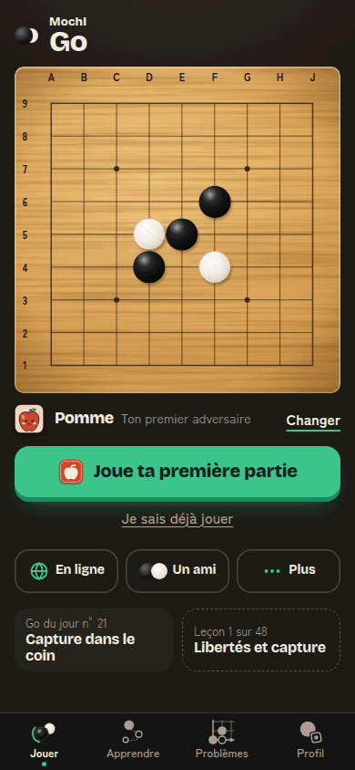

### 2.4 Apprendre (nouveau joueur et habitué) : propositions seulement

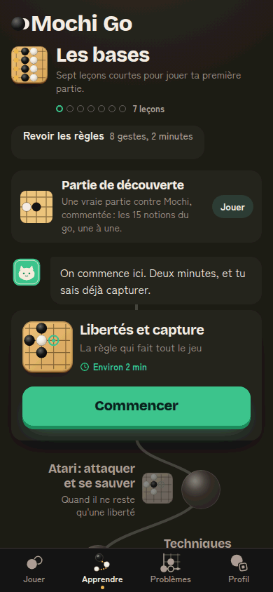 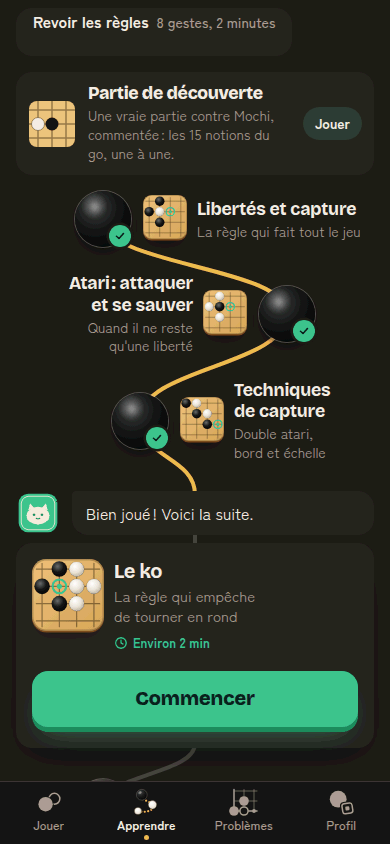

Un autre agent travaille sur cet onglet (#589, #590, #591) : **rien n'est changé ici**. Voir la section 4.

### 2.5 Problèmes, la liste

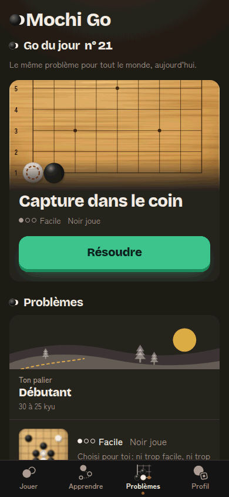

- **Action voulue** : « Résoudre » le Go du jour ; une fois fait, « Problème suivant ».
- **Premier regard** : le titre « Go du jour n° 21 », puis la phrase grise sous le titre, puis le plateau et « Résoudre ». Sous le pli : un paysage, trois lignes de palier, une carte « Problème suivant » avec une phrase d'aide, une carte « Course » de trois lignes, « Par thème » et six vignettes, « Tous les problèmes », la série.
- **Détourne** :
  - « Le même problème pour tout le monde, aujourd'hui. » : sous le titre, avant le plateau ;
  - « Noir joue », deux fois (Go du jour, Problème suivant) : la consigne du problème le dit déjà (« Tu joues Noir ») ;
  - le palier : « Ton palier », « Débutant », « 30 à 25 kyu » (le mot « kyu » sans explication) ;
  - « Choisi pour toi : ni trop facile, ni trop difficile. » ;
  - la carte Course : « Un maximum de problèmes. À la 3e erreur, la course s'arrête. » (la consigne de la course le redit, règle par règle, avant de partir) ;
  - « 0 jour de série » en grand, en bas : un zéro en or n'encourage personne.
- **Décision** (lot B) :
  - « Le même problème pour tout le monde, aujourd'hui. » **coupé** ;
  - « Noir joue » **coupé** des deux cartes (gardé dans la consigne du problème) ;
  - palier : « Ton palier » et « 30 à 25 kyu » **coupés** ; le nom du palier reste sur son paysage. Le rang en kyu reste dans « Tous les problèmes », en tête de chaque palier ;
  - « Choisi pour toi… » **coupé** ;
  - carte Course : la phrase **coupée**, le titre reste, le record s'affiche s'il existe ;
  - série : **masquée à zéro** ; elle revient dès le premier jour (E7 : un chiffre seulement s'il fête un progrès) ;
  - chevrons « › » de la carte Course et de « Tous les problèmes » **retirés** (DESIGN.md, « Don't ») ; chrono de la carte Course de 56 à 40 px (E13 : une seule image forte, le goban du jour).
- **Règles** : E4 (sous-titre coupé), E6 (« Choisi pour toi », phrase de la Course), E7 (rang en kyu, série à zéro), E8 (« Noir joue » redit par la consigne).
  - **Gardé** : la phrase « Le tesuji, c'est le coup malin qui change tout. » (règle 5 : le mot est expliqué là où il apparaît ; c'est sous le pli, elle ne rivalise pas avec « Résoudre »).

### 2.6 Problèmes, pendant un problème

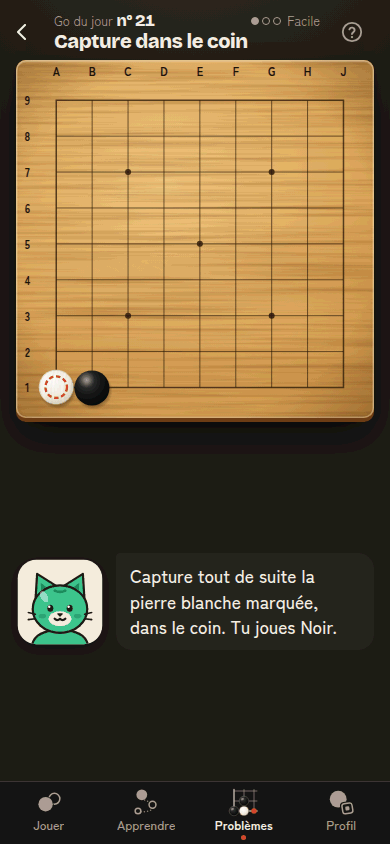

- **Action voulue** : poser la pierre sur le plateau.
- **Premier regard** : le titre, puis le plateau, puis la consigne de Mochi.
- **Détourne** : la difficulté (« ●○○ Facile ») en haut à droite, à côté de l'aide. Elle a servi à choisir le problème ; pendant qu'on le résout, elle n'apporte rien.
- **Décision** (lot B) : difficulté **coupée** de l'en-tête du lecteur dans l'onglet Problèmes (E8 : déjà lue sur la carte qui l'ouvre ; elle reste sur les cartes et dans la grille). Le même lecteur sert à l'entraînement des leçons (onglet Apprendre) : là, inchangé. L'écran est déjà calme : une consigne, un plateau.

### 2.7 Profil

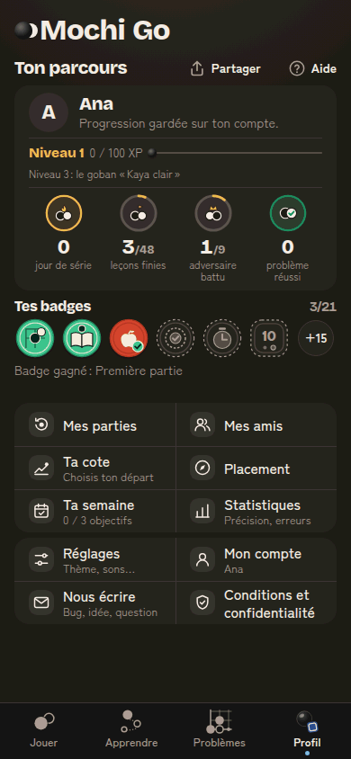

- **Action voulue** : aucune action principale (Profil est un tableau de bord). Ce qu'on vient chercher : sa progression, puis un réglage.
- **Premier regard** : « Ton parcours », puis la carte d'identité, qui empile 5 lignes : nom, « Progression gardée sur ton compte. », niveau et XP, « Niveau 3 : le goban « Kaya clair » », et quatre anneaux chiffrés. Puis les badges et leur légende, puis 10 lignes dont 8 ont un sous-titre.
- **Détourne** :
  - « Progression gardée sur ton compte. » (rassurant une fois, pas à chaque visite) ;
  - « Niveau 3 : le goban « Kaya clair » » (la récompense à venir, déjà dans le détail du niveau) ;
  - « Badge gagné : Première partie » sous la rangée (se lit en touchant le badge) ;
  - les sous-titres des lignes : « Choisis ton départ », « 0 / 3 objectifs », « Précision, erreurs », « Thème, sons… », « Bug, idée, question ».
- **Décision** (lot C, à venir) : ces cinq textes **coupés** ou **repliés** dans l'écran qu'ils annoncent (E6, E7). Gardés : le nom, le niveau, les quatre anneaux, la rangée de badges, le pseudo sous « Mon compte ».

### 2.8 Partie contre l'ordi

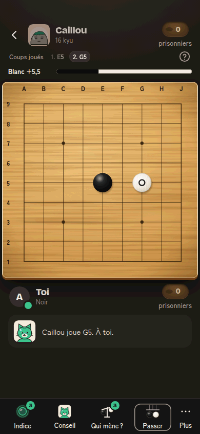

- **Action voulue** : poser une pierre.
- **Premier regard** : le plateau (bien), puis la barre d'actions, dont trois boutons portent une pastille « 3 ».
- **Détourne** :
  - le mot « prisonniers » sous chacun des deux couvercles (le chiffre suffit ; le mot est expliqué dans l'aide) ;
  - le libellé « Coups joués » devant la liste des coups ;
  - les pastilles « 3 » sur Indice et Qui mène ? (un compteur de jetons, pas un état urgent).
- **Décision** : **non faite dans ce chantier** (Game.tsx est l'écran le plus testé ; P5 de #571 attend la mesure `indice_demande` pour décider la barre). Proposition : « prisonniers » gardé au premier coup pris de la première partie seulement, puis remplacé par le nom accessible ; « Coups joués » en lecteur d'écran seulement.

### 2.9 Fin de partie

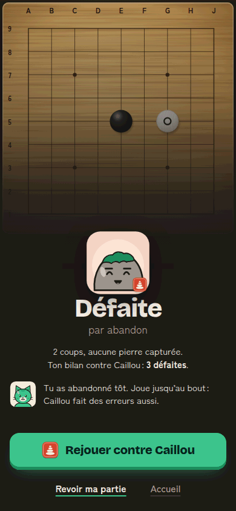

- **Action voulue** : « Rejouer contre Caillou ».
- **Premier regard** : le sceau de Caillou, « Défaite », puis quatre lignes de texte (« par abandon », deux lignes de bilan, la bulle de Mochi).
- **Détourne** : « 2 coups, aucune pierre capturée. » et « Ton bilan contre Caillou : 3 défaites » disent deux choses de plus que la bulle de Mochi, qui est la vraie leçon.
- **Décision** (lot C, à venir) : le résumé chiffré **replié** dans « Revoir ma partie » (E7 : trois chiffres dans un bloc) ; gardés : le résultat, « par abandon », la phrase de Mochi, le bouton, les deux liens.

### 2.10 Une leçon

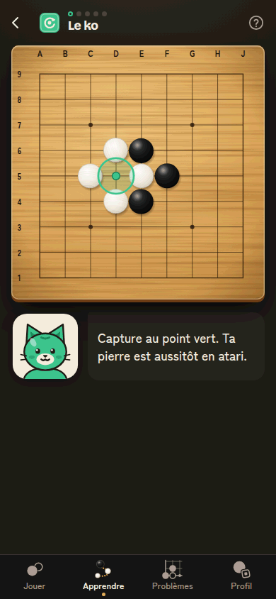

- **Action voulue** : jouer le coup demandé.
- **Premier regard** : le plateau et le point vert, puis la consigne de Mochi. Déjà épuré.
- **Décision** : rien à couper. La leçon dépend d'Apprendre (autre agent) : aucune modification.

## 3. Tableau Épure, avant et après

Au premier regard (390 × 844, sans défiler, au-dessus de la barre du bas), comptage de `DESIGN.md` : blocs (E2, en-tête de l'app et barre du bas exclus), plus grand groupe de même poids (E3), phrases de Mochi ou de l'adversaire (E5), lignes de détail sous un libellé (E6), chiffres (E7). Sombre et clair comptent pareil.

| Écran | Blocs (E2) | Plus grand groupe (E3) | Phrases (E5) | Lignes de détail (E6) | Chiffres (E7) |
|---|---|---|---|---|---|
| Jouer, premier lancement | 4 → 4 | 1 → 1 | 1 → 1 | 1 → 1 (« Ton premier adversaire ») | 1 (« 9 × 9 ») → 0 |
| Jouer, après la 1re pierre | **6 → 5** | 3 → 3 | 1 → 0 | 5 → 2 | 3 → 2 (n° du jour, leçon 1 sur 48) |
| Jouer, habitué | **6 → 5** | 3 → 3 | 2 → 1 | 4 → 1 | 5 → 5 (grade, cote, taille, n° du jour, leçon : voir la tension en 2.3) |
| Problèmes, liste | 4 → 3 | 1 → 1 | 0 → 0 | 4 → 1 (« Facile ») | 3 → 2 (n° du jour, difficulté) |
| Problèmes, en cours | 3 → 3 | 1 → 1 | 2 → 2 | 1 → 0 | 2 → 1 |
| Profil (lot C, avant seulement) | 4 | 6 + 4 | 0 | 8 | 9 |
| Partie (proposition, avant seulement) | 5 | 5 (barre) | 1 | 2 (« prisonniers ») | 4 |
| Fin de partie (lot C, avant seulement) | 4 | 1 | 1 | 2 | 3 |
| Leçon (rien à faire) | 3 | 1 | 2 | 0 | 0 |

E1 (une seule action en relief) tenait déjà partout et tient toujours (`e2e/accueil-premier-lancement.spec.ts`, `uneSeuleAction`).

## 4. Lots

| Lot | Branche | Écrans | État |
|---|---|---|---|
| A | `epure-592-a` | Audit, captures avant, Jouer (2.1 à 2.3) | fait |
| B | `epure-592-b` | Problèmes (2.5, 2.6) | fait (captures après 05 et 06 sur cette branche) |
| C | `epure-592-c` | Profil, fin de partie (2.7, 2.9) | à venir |

Captures après : `docs/ux/captures/epure-apres/`, mêmes noms que les captures avant.

## 5. Propositions pour Apprendre (à faire après #589, #590, #591)

Constat (capture 04b, nouveau joueur) : avant « Commencer », le regard traverse le titre de l'app, le titre du chapitre et sa phrase, 7 pastilles et « 7 leçons », « Revoir les règles · 8 gestes, 2 minutes », la carte « Partie de découverte » (3 lignes et un bouton « Jouer »), la bulle de Mochi, puis la carte de la leçon (titre, sous-titre, « Environ 2 min »). Cinq choses parlent avant le bouton. Plus bas, chaque leçon verrouillée porte sa pastille « Avec un compte » : une quarantaine de fois la même phrase sur la page.

Propositions, dans l'ordre d'impact :

Règles touchées : E2 (8 blocs avant « Commencer »), E5 (deux voix, Mochi et la carte), E7 (« 8 gestes, 2 minutes », « Environ 2 min », « 7 leçons »), E8 (deux fois la durée), E6 (sous-titres sur le chemin).

1. **« Partie de découverte » sort du haut de l'onglet.** Elle est déjà dans Jouer → Plus. Sur Apprendre, une ligne discrète à la fin du chapitre « Les bases » (« Une vraie partie commentée par Mochi »), sans bouton plein. C'est la carte qui rivalise le plus avec « Commencer » : un second bouton, à la même hauteur.
2. **« Revoir les règles » devient un lien discret**, sans « 8 gestes, 2 minutes », sous le chemin ou dans l'aide (?). Pour un nouveau joueur, la leçon 1 fait déjà ce travail.
3. **Une seule durée.** La bulle dit « Deux minutes », la carte dit « Environ 2 min » : garder la carte, couper la durée de la bulle ; pour un habitué, la bulle de Mochi ne parle que s'il a quelque chose de neuf à dire (nouveau chapitre, retour après une absence).
4. **En-tête de chapitre** : titre et pastilles ; la phrase (« Sept leçons courtes… ») et « 7 leçons » coupées (les pastilles comptent déjà).
5. **Chemin** : les sous-titres des leçons (« La règle qui fait tout le jeu ») seulement sur la carte de la prochaine leçon ; sur le chemin, les titres seuls.
6. **« Avec un compte »** : une seule ligne au premier palier verrouillé (« La suite du chemin s'ouvre avec un compte »), plus une pastille par leçon.
7. **Titre de l'app** : sur Apprendre, Problèmes et Profil, « Mochi Go » prend 60 px au-dessus du titre de l'écran. Proposition transversale : la marque sur Jouer seulement, le titre de l'écran ailleurs (comme chess.com). Touche `src/app/App.tsx` et les quatre onglets : à faire d'un bloc, après Apprendre.

Indicateurs à suivre : `lecon_commencee / onglet_apprendre_vu` (taux de clic sur « Commencer »), et `mode_choisi { mode: 'decouverte' }` pour vérifier que la partie de découverte reste trouvée depuis Jouer.

## 6. Budget et contrôles

Chiffres du build de production (`npm run build && node scripts/budget-bundle.mjs`), mis à jour à chaque lot dans sa PR.

| | `main` (`6023e07`) | Lot A | Lot B |
|---|---|---|---|
| JS initial (gzip) | 149,61 / 150 Ko | 149,45 Ko | 149,60 Ko |
| CSS initial (gzip) | 21,41 / 22 Ko | 21,38 Ko | 21,41 Ko |
| Puzzles, à la demande | 24,43 Ko | inchangé | 24,35 Ko |
