# Contextuel, visuel, responsive : 17 octobre 2026 (#615)

Auteur : agent `ux-jeux-mobiles`. Demande de Florian, après ses retours #592, #613 et #614 : « Je te laisse comprendre les modifications que je t'ai demandées et faire de même sur le reste. L'application doit être responsive et la plus visuelle possible. »

Cet audit ne change aucun code applicatif. Il pose les règles P1 à P9 (`DESIGN.md`, section « Principes de Florian »), relève ce qui les enfreint sur chaque écran, propose une stratégie responsive dans le design system actuel, puis un plan en lots.

## 1. Méthode

- **Code** : `main` à `744dbf8`. Lus : `src/ui/tokens.css`, `app.css`, `nav.css`, `accueil.css`, `partie.css`, `apprendre.css`, `themes.css`, `course-ecran.css`, `ouvertures.css` ; `src/app/Puzzles.tsx`, `src/ui/SeriesThemes.tsx`.
- **App** : build de test (`VITE_E2E=1`), `vite preview` sur le port 4405, Chromium de `/opt/pw-browsers`, `fr-FR`, mouvements réduits, faux Supabase (`e2e/fauxSupabase.ts`).
- **Joueurs** : un nouveau (aucune pierre posée) ; un habitué avec un compte (6 parties, Pomme battue, 3 leçons finies, une amie, Chloe, avec 4 parties classées) ; un joueur sans compte dont l'essai est fini (création de compte).
- **Captures** : `e2e/visuel-responsive-captures.spec.ts`, ajouté par ce lot et lancé à la main seulement (`VISUEL=<dossier> npx playwright test visuel-responsive-captures --workers 3`). 22 vues × 7 tailles, en sombre, plus le clair à 390. Le spec relève aussi, pour chaque vue, la hauteur du document, le débordement horizontal, la largeur de `.app`, la taille et le bas de chaque goban, et le nombre de boutons en relief. Il servira de base aux captures « après ».
- **Tailles** : 360 × 780, 390 × 844, 430 × 932 (téléphones) ; 768 × 1024 (tablette en portrait) ; 1024 × 768 (tablette en paysage) ; 1440 × 900 (ordinateur) ; 844 × 390 (téléphone en paysage).
- **Retours de Florian sur Problèmes** (relayés le 17/10, sa capture sert de modèle aux cartes de thème) : six défauts, chacun vérifié dans le code (§ 3).

## 2. Captures « avant »

Les plus parlantes, réduites et allégées (`docs/ux/captures/visuel-responsive/`). Les PNG complets restent à régénérer avec le spec.

| | |
|---|---|
| 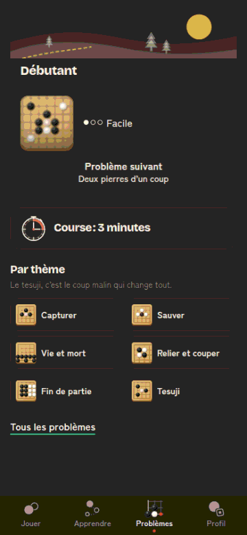 | 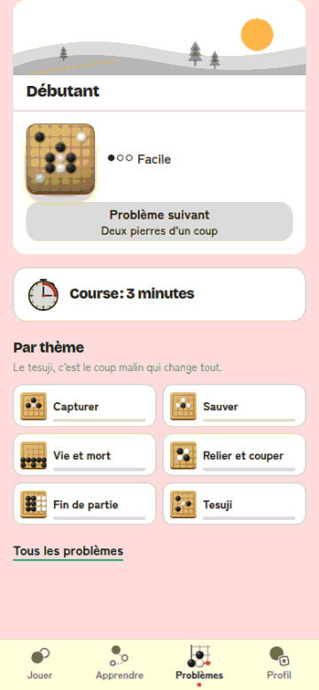 |
| **01-02.** Problèmes après défilement, à 390 : mini-goban et « Facile » seuls dans la carte, bouton gris, course cernée, phrase sur le tesuji. | Le même en clair : la course, avec sa bordure, est le bloc le plus net. |
| 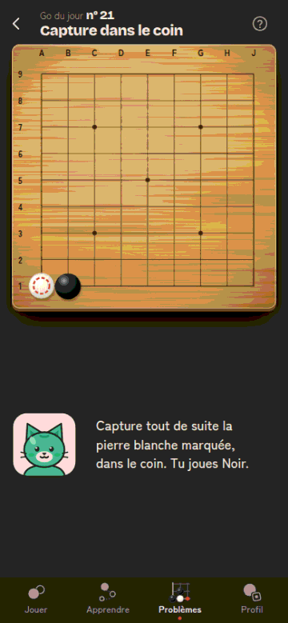 | 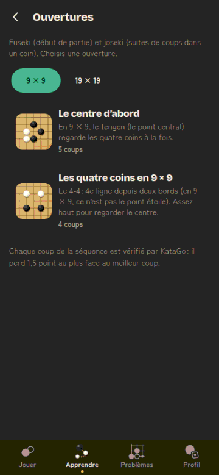 |
| **03.** Problème à 390 : 130 px de vide entre le goban et Mochi. | **04.** Ouvertures : choix 9 × 9 en aplat jade (E1), cartes à 3 lignes de texte et « 5 coups ». |
| 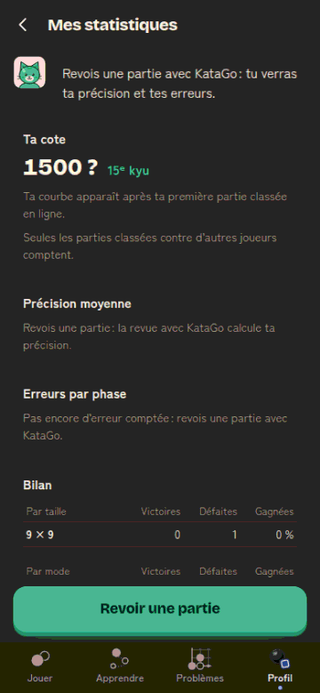 | 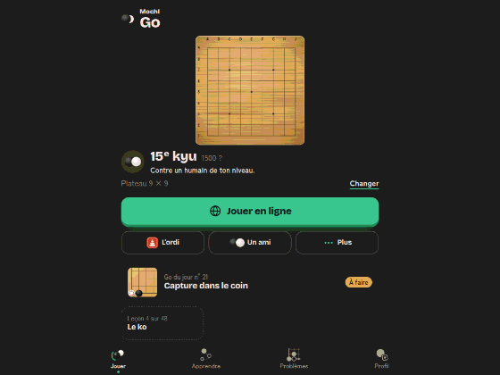 |
| **05.** Statistiques sans partie classée : une cote « 1500 ? » et trois cartes d'états vides en texte. | **06.** Jouer sur tablette en paysage : goban de 224 px au milieu d'une colonne de 560. |
| 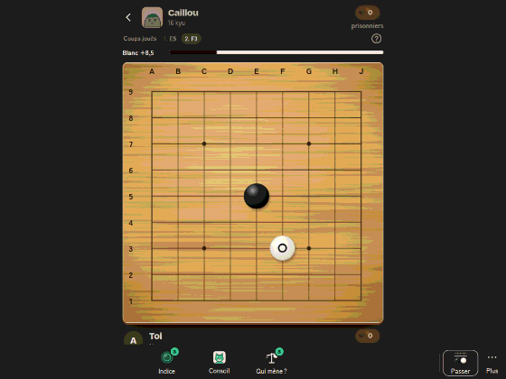 | 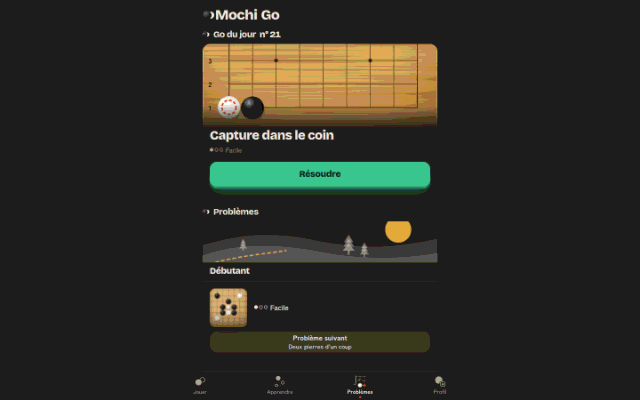 |
| **07.** Partie sur tablette en paysage : ton bandeau passe sous la barre d'actions, la page défile. | **08.** Problèmes sur ordinateur : une colonne de 560 px au milieu de 1440, barre du bas. |
| 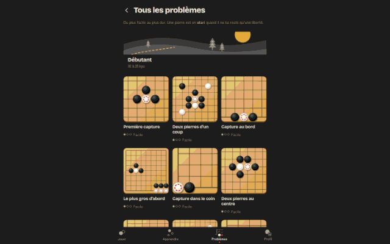 | 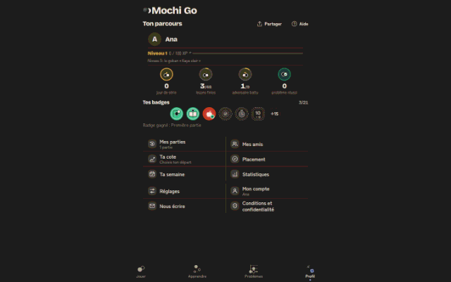 |
| **09.** Tous les problèmes : 3 colonnes là où 5 tiendraient. | **10.** Profil : 880 px de marges vides. |
| 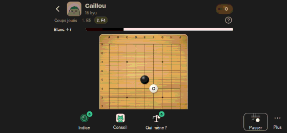 | 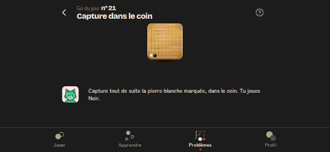 |
| **11.** Partie en paysage : le goban est coupé par la barre d'actions. | **12.** Problème en paysage : goban de 90 px. |
| 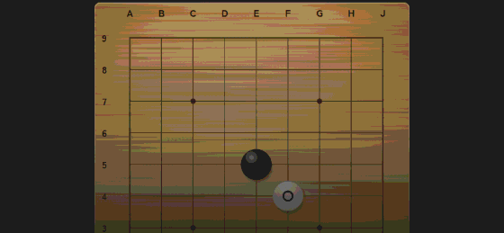 | |
| **13.** Fin de partie en paysage : on ne voit que le goban, le résultat est hors de l'écran. | |

## 3. Les retours de Florian sur Problèmes, vérifiés dans le code

| # | Ce que voit Florian | Vérification | Verdict | Principe |
|---|---|---|---|---|
| F-a | Le paysage du palier passe sous la barre d'état : l'heure s'affiche sur le dessin. | `body` a `padding-top: env(safe-area-inset-top)` (`app.css`, l. 9) avec `viewport-fit=cover` (`index.html`) : la marge part avec le défilement, rien ne couvre ensuite la zone de la barre d'état. Chromium n'a pas d'encoche : non reproductible ici, à confirmer sur iPhone. #612 retire le paysage de la liste, mais le défaut reste pour tout ce qui défile (Go du jour, chemin d'Apprendre). | **Confirmé** (par le code) | P9 |
| F-b | Carte « Novice · 31 réussis » : un grand mini-goban, puis « ●●○ Moyen » flotte seul à droite. | `Continuer` (`Puzzles.tsx`, l. 526) : grille `84px 1fr` ; le corps ne contient plus que la difficulté depuis #592 (« qui joue » retiré). Capture 01 : « Facile » seul au milieu de 280 px. | **Confirmé** | P2, P7 |
| F-c | « Problème suivant · Le ko qui sauve » est un bouton gris ; rien n'est en relief. | La carte est en relief seulement quand le Go du jour est fait (`principal={duJourFait}`, l. 473 et 476). Sinon, le relief est le « Résoudre » du Go du jour, **au-dessus** : dès qu'on défile (ce que montre la capture de Florian, cf. F-a), il n'y a plus aucun relief à l'écran. | **Confirmé**, avec la cause | P6 (E1) |
| F-d | « Le tesuji, c'est le coup malin qui change tout. » n'explique qu'un thème sur six. | `VignettesThemes` (`SeriesThemes.tsx`) : `themes.aide` affiché dès que la série tesuji existe. | **Confirmé** | P4 |
| F-e | « Tous les problèmes » en lien, puis un énorme « 🔥 2 jours de série » aligné à droite ; bloc orphelin, grand vide dessous. | `.palmares` : grille `1fr auto`, `.palmares-serie:only-child { grid-column: 2 }`, `.chiffre` à 3,25rem (52 px) (`apprendre.css`, l. 289 à 297). Puis 150 px de marge basse de `.app`. | **Confirmé** | P7, P5 ; carte d'architecture : la série a sa maison au Go du jour |
| F-f | « Course : 3 minutes » pèse autant que la carte principale. | `.course-carte` : 64 px, titre Bricolage 800 en `--fs-l`, chrono de 40 px et **bordure** de 1,5 px `--line` (`course-ecran.css`, l. 6), alors que la carte « Problème suivant » n'a pas de bordure. En clair (capture 02), la course est le bloc le plus net. Même bordure sur `.theme-carte`, contraire à « tuiles sans bordure » (Components). | **Confirmé** | P7 |

## 4. Audit écran par écran

Légende de gravité : **haute** (on ne peut pas jouer ou on ne voit pas l'action), **moyenne** (le regard part ailleurs, effort inutile), **basse** (finition). « Défilement » : hauteur du document / hauteur de l'écran, mesurée par le spec. Les lignes déjà traitées par une PR en cours le disent ; elles ne donnent pas lieu à un lot.

| Écran | Contextuel (trop tôt) | Visuel (texte → cartes, visuel existant) | Responsive | Gravité |
|---|---|---|---|---|
| **Jouer, nouveau** | Rien : un goban, un adversaire, un bouton. | Bien. | Paysage : défilement 1,3, bouton sous la ligne. 1440 : goban de 528 px, colonne de 560. | basse |
| **Jouer, habitué** | Grade, cote « 1500 ? », « Plateau 9 × 9 », niveau (**#613 en cours**). | Tuiles Go du jour (mini-goban) et Leçon 4 (sans visuel : la vignette de la leçon existe dans Apprendre, `.continuer-carte`). | 1024 × 768 : goban de 224 px (capture 06). Paysage : défilement 1,8, bouton hors écran. | moyenne |
| **Lancement (feuille « Changer »)** | La phrase sur le kyu s'affiche à chaque ouverture : utile la première fois seulement. | Déjà en cartes (portraits, sceaux, cadenas) : modèle à garder. Taille du plateau en `.seg` texte : un mini-goban 9/13/19 l'expliquerait sans phrase (« Parties courtes, idéal pour apprendre »). | 1440 : bonne largeur. Paysage : la feuille défile (92dvh). | basse |
| **Partie** | « Coups joués », « prisonniers » (**#610 en cours**). | Bien : le goban d'abord. | 1024 × 768 : défilement 1,2, ton bandeau sous la barre d'actions (capture 07). 1440 : 905 px pour 900. Paysage : goban coupé (capture 11). | **haute** (tablette, paysage) |
| **Fin de partie** | « Ton bilan contre Caillou : 3 défaites » : un compteur de défaites n'aide pas à rejouer (E7). | Bien (portrait, tampon, Mochi). | Paysage : défilement 2, résultat invisible (capture 13). 1440 : goban de 528 px en fond, texte sur 980 px de large (phrase de Mochi sur une ligne de 90 signes). | **haute** (paysage) |
| **Apprendre** | Découverte, guidée, règles en haut (**#609**). | Thèmes en puces de texte (**#614**). | Défilement 6 à 7,5 écrans à toutes les tailles ; le chemin reste une colonne de 560 px à 1440. | moyenne |
| **Page d'un thème** | « 1 sur 3 » à côté de « Les leçons » (E7). | Lignes de leçons avec vignette et statut « Faite / À faire » en pastilles texte : le sceau de leçon existe (`SceauLecon`) et dirait « faite » sans mot. La phrase d'introduction répète celle de la leçon. | 390 : 300 px de vide entre la liste et le bouton. 1440 : colonne de 560. | basse |
| **Leçon** | Petit sceau de la barre (**#610**). | Bien. | 390 : 230 px de vide sous Mochi (déjà relevé par #509). Paysage : Mochi coupé par la barre du bas (N2 retirera la barre). | moyenne |
| **Ouvertures (liste)** | « 5 coups », « 4 coups » (E7). Phrase de bas de page sur KataGo : une preuve, pas une décision. | Cartes à 3 lignes de description (P2) ; choix 9 × 9 / 19 × 19 en **aplat jade** (`.ouv-taille[aria-pressed]`, `ouvertures.css`, l. 16) : seul aplat jade d'un écran sans action principale, contraire à E1 et à `.seg` (capture 04). | 768 et plus : lignes de 75 à 81 signes. | moyenne |
| **Une ouverture** | « Touche « Suivant » pour voir le premier coup » répète le bouton (E6). | Bien (goban). | 1024 × 768 : goban de 407 px dans 768 de haut, correct. Paysage : défilement 1,4. | basse |
| **Problèmes** | Série en bas, en 52 px (F-e). | Carte « Problème suivant » creuse (F-b) ; phrase du tesuji (F-d) ; course trop forte (F-f) ; Go du jour : grand goban recadré, bien. | 390 : 1,6 écran ; l'action sort de la vue au défilement (F-c). 1440 : colonne de 560 (capture 08). Paysage : 3,4 écrans. Barre d'état (F-a). | **haute** (F-c) |
| **Problème** | Rien. | Bien. | 390 : 130 px de vide entre goban et Mochi (capture 03). Paysage : goban de 90 px (capture 12). | **haute** (paysage) |
| **Course (consigne)** | Rien. | Quatre règles en tuiles identiques avec un point hanko : une pile de cartes semblables (Shapes) ; trois suffisent (« 3 minutes » est déjà dans le titre). | Bien. | basse |
| **Course** | Rien. | Bien. | 1024 × 768 : défilement 1,1, bas du goban à 712 px. Paysage : 2,3 écrans. | moyenne |
| **Tous les problèmes** | « 30 à 25 kyu » sous le palier : utile ici (choisir son niveau). | Déjà en cartes : modèle. Vignettes de 175 px à 390 : 4,7 écrans pour un palier. | 1440 : 3 colonnes dans 560 px, 5 tiendraient dans 1080 (capture 09). | moyenne |
| **Profil** | « 0 jour de série », « 0 problème réussi » (P1, #592 l'a déjà fait dans Problèmes). Titre « Ton parcours » (**#607**). | Menu en grille 2 colonnes avec icônes dessinées : bien. | 1440 : 880 px de marges (capture 10). | basse |
| **Statistiques** | Cote « 1500 ? » et « 15e kyu » avant toute partie classée (P1) ; trois états vides de deux phrases (capture 05). | Une courbe, une précision, des erreurs par phase : des visuels « fantômes » (courbe grise, jauge vide) diraient « bientôt ici » sans phrase. | 390 : 1,2 écran. ≥ 768 : les quatre blocs tiendraient en grille 2 × 2. | moyenne |
| **Réglages** | Rien. | Aperçu du goban et vignettes de thème du plateau : modèle de choix visuel. | 2,1 écrans à 390, liste unique à 1440 ; deux colonnes (Apparence, Plateau ; Partie, Compte) dès 1024. | basse |
| **Mes amis** | « Défier lance une partie 9 × 9 : ton ami joue le premier, 3 jours par coup. » sous la liste : utile au moment de défier, pas avant (P1). | Avatar en lettre : le portrait du profil public (pierres de la bande) n'existe pas en petit ; garder la lettre. | Bien. | basse |
| **Profil public** | Grade, cote, parties classées : servent la décision « Défier » : à garder. Phrase du défi sous le bouton : idem Mes amis. | Bande de pierres : bien. Dernières parties en lignes : correct (historique). | Paysage : 2 écrans. | basse |
| **Création de compte** | La liste « tout ce que tu as fait est gardé » répond à la peur de perdre : à garder. | Bien (Mochi). | 360 et 390 : 1,2 à 1,3 écran, « Plus tard » sous la ligne (la sortie « ‹ » reste en haut). Paysage : 2,2 écrans. | basse |

### Ce que montrent les mesures, toutes tailles

- **Aucun débordement horizontal**, à aucune taille ni sur aucun écran : la base (#121, 320 px) est solide.
- **La colonne s'arrête à 560 px partout** à partir de 768 : sur un écran de 1440, 61 % de la largeur est vide ; les grilles gardent leur nombre de colonnes de téléphone.
- **Le goban de la partie fait 528 px dès 600 px de large**, quelle que soit la hauteur : il déborde à 1024 × 768 (bas à 654 + barre d'actions) et à 844 × 390. Seule la règle `max-height: 700px` le réduit, et seulement pour les petits téléphones.
- **La barre du bas reste en bas jusqu'à 1440**, onglets plafonnés à 180 px et centrés. Sur ordinateur, la référence (chess.com, Lichess, Duolingo web) est une barre latérale.
- **Longueur de ligne** : 50 à 60 signes à 390, 75 à 83 à partir de 768 (Ouvertures, Profil, Réglages). Au-delà de 75 signes, une ligne devient difficile à suivre (*hypothèse* courante en typographie, non mesurée chez nous).
- **Téléphone en paysage** : toutes les activités sont inutilisables (goban coupé ou de 90 px, fin hors écran). Le manifeste déclare `"orientation": "portrait"`, ce qui verrouille l'app installée sur Android, mais ni Safari ni l'app installée sur iOS ne le respectent.

## 5. Stratégie responsive

Elle prolonge ce qui existe (jetons de `tokens.css`, `@media (min-width: 600px)` de `partie.css` et `fin.css`, requêtes de conteneur de l'accueil) au lieu de le remplacer. Classes de largeur alignées sur celles d'Android ([window size classes](https://developer.android.com/develop/ui/compose/layouts/adaptive/window-size-classes) : compacte < 600 dp, moyenne 600 à 839, étendue 840 et plus ; hauteur compacte < 480 dp).

### 5.1 Points de rupture

| Classe | Requête | Mise en page | Navigation |
|---|---|---|---|
| Téléphone | `< 600px` | Aujourd'hui : colonne unique, gouttière 16 px. Inchangé. | Barre du bas. |
| Tablette | `(min-width: 600px)` | Contenu jusqu'à `--largeur-contenu` (720 px). Texte courant plafonné à `--mesure` (36rem). Grilles de cartes à 3 colonnes au moins. Activités : goban à la hauteur disponible. | Barre du bas (comme iPadOS en portrait). |
| Large | `(min-width: 1024px)` | Contenu jusqu'à `--largeur-large` (1080 px). Racines : grilles de 4 à 5 colonnes, Profil et Statistiques en deux colonnes. Activités et Jouer en deux zones : goban à gauche, panneau à droite (360 px). | **Barre latérale** à gauche (`--rail-l` 88 px, mêmes icônes `IconesNav`, libellés dessous). |
| Paysage bas | `(orientation: landscape) and (max-height: 479px)` | Activités en deux zones, comme « Large ». Racines : colonne unique, on accepte le défilement. | Barre latérale compacte (64 px), pour rendre la hauteur au goban. |

On garde `max-width: 359px` et les `max-height` existants : ils règlent les petits téléphones, pas les grands écrans.

### 5.2 Largeur du contenu

- `--largeur-max` (560 px) reste la largeur d'une **colonne de lecture** (texte, formulaires, feuilles, écrans de compte).
- Nouveaux jetons : `--largeur-contenu: 720px`, `--largeur-large: 1080px`, `--mesure: 36rem`, `--rail-l: 88px`. `.app` prend `--largeur-contenu` à partir de 600 et `--largeur-large` à partir de 1024 ; les paragraphes et bulles gardent `max-width: var(--mesure)`.
- Le bouton fixe (`.cta`) suit la colonne : `width: min(528px, 100% − 32px)` reste vrai ; avec la barre latérale, il se centre dans la zone de contenu (décalé de `--rail-l`).

### 5.3 Goban

- Une seule règle pour toutes les activités : le goban est dans une zone `container-type: size` qui reçoit la place restante (comme `.scene` de l'accueil), et vaut `min(100cqw, 100cqh)`. Plus de taille calculée à partir de `100dvh − N px` écran par écran (`partie.css`, l. 140 et 146).
- En deux zones (large et paysage bas) : la zone du goban prend toute la hauteur moins la barre d'actions ; le panneau de droite porte bandeaux, Mochi, coups joués et actions.
- Plancher : 260 px pour le 9 × 9 (décision #527). En dessous, le panneau passe sous le goban et la page défile, plutôt que de couper le goban.
- Hors activité (Jouer, Go du jour, Réglages), le goban d'illustration plafonne à 480 px : il illustre, il ne doit pas pousser l'action hors de l'écran.

### 5.4 Grilles

- Cartes de choix (thèmes de Problèmes et d'Apprendre, ouvertures, paliers) : `repeat(auto-fill, minmax(10rem, 1fr))`. Donne 2 colonnes à 360 et 390, 3 à 430 si le nom tient, 4 à 720, 6 à 1080.
- Vignettes de problèmes (`.grille-pb`) : `minmax(7rem, 1fr)` au lieu de 8rem : 3 colonnes à 390 (110 px, lisible pour un 5 × 5), 6 à 720, 8 à 1080. Le défilement de Tous les problèmes passe de 4,7 à environ 3 écrans.
- Profil : badges sur une ligne entière ; menu en 3 colonnes à partir de 1024.

### 5.5 Navigation

- Moins de 1024 : barre du bas, inchangée.
- 1024 et plus, et paysage bas : la même barre devient latérale (`.nav` en colonne, `position: fixed; inset: 0 auto 0 0`). Les décalages « au-dessus de la barre » (`74px` du `.cta`, `scroll-padding-bottom`, `.dock`, pastille XP) passent par une variable `--nav-bas` qui vaut 0 quand la barre est latérale.
- Les activités n'ont pas de barre du tout (A5, lot N2) : la barre latérale ne les concerne pas.

## 6. Plan en lots

Une issue, une branche, une PR par lot. Tailles : XS (moins d'une demi-journée), S (une journée), M (deux à trois jours), L (une semaine). Chaque lot cite les règles P qu'il fait passer au vert et refait les captures avec `e2e/visuel-responsive-captures.spec.ts`.

PR en cours dont ce plan tient compte, sans les refaire : #607 (N7, noms), #608 (N0, modèle de navigation), #609 (épure d'Apprendre), #610 (partie et leçon), #611 (en-têtes), #612 (visuels décoratifs, dont le paysage du palier hors de la liste Problèmes), #613 (Jouer à l'ouverture, branche `jouer-ouverture-613`), #614 (grille des thèmes d'Apprendre, branche `apprendre-grille-614`), N1 (retour du système, branche `archi-n1-606`).

| Lot | Contenu | Écrans | Risque | Tests e2e concernés | Taille | Dépend de |
|---|---|---|---|---|---|---|
| **V0** | **Garde-fou responsive.** `e2e/responsive.spec.ts` aux 7 tailles : pas de débordement horizontal ; activités sans défilement ; goban entier visible ; un relief au plus. Les cas qui échouent aujourd'hui (tablette en paysage, paysage bas) sont dans la liste `CONNU` du spec, avec leur lot, et nommés par un `test.fixme` ; V5 et V6 les retirent un par un. Fait par #619 : 7 écrans × 7 tailles, plus un plancher de 260 px pour le goban des activités. | aucun visible | faible | nouveau `responsive.spec.ts` | S | — |
| **V1** | **Problèmes : la carte d'action.** Une seule carte d'action en tête : le Go du jour tant qu'il n'est pas fait, puis « Problème suivant » (mini-goban, titre et difficulté sur une ligne, bouton en relief dans la carte). L'autre devient une tuile secondaire. Course : tuile à plat, sans bordure, chrono de 32 px, titre en `--fs-m`. Série : pastille `.serie` à côté du titre du Go du jour ; le bloc `.palmares` disparaît, « Tous les problèmes » finit la page. Retours F-b, F-c, F-e, F-f. | Puzzles, `apprendre.css`, `course-ecran.css` | moyen : `principal` et la série sont lus par beaucoup de tests | `problemes.spec.ts`, `course-problemes.spec.ts`, `go-du-jour.spec.ts`, `serie-*.spec.ts`, `flamme-du-jour.spec.ts`, `experience-problemes.spec.ts`, `une-chose-a-la-fois.spec.ts`, `loi-de-hick.spec.ts` | M | #611 (titre « Entraînement »), #612 (paysage retiré), #607 (lien « Créer mon compte ») |
| **V2** | **Thèmes : une explication par carte.** Phrase du tesuji retirée (F-d) ; le mot s'explique dans la page de la série (première consigne) et dans l'`aria-label` de la carte. Bordure des `.theme-carte` retirée (tuiles sans bordure). Grille `auto-fill` (§ 5.4). | SeriesThemes, `themes.css` | faible ; le composant est partagé avec #614 | `problemes-par-theme.spec.ts`, `apprendre-themes.spec.ts`, `glossaire` (Vitest) | S | **#614** (même composant : partir de sa branche fusionnée) |
| **V3** | **Zone sûre du haut au défilement.** Une bande fixe de hauteur `env(safe-area-inset-top)` sur `--bg` (ou en-tête collant) pour toutes les racines et écrans de tâche. F-a. | `app.css` | faible | `petits-ecrans.spec.ts`, `zoom.spec.ts` ; contrôle manuel sur iPhone (Chromium n'a pas d'encoche) | XS | — |
| **V4** | **Ouvertures en cartes.** Choix de taille en `.seg` (fin de l'aplat jade) ; liste en grille de cartes (mini-goban, nom), description et nombre de coups à l'écran de l'ouverture ; phrase KataGo dans l'écran de l'ouverture. Phrase « Touche Suivant » retirée. | Ouvertures, `ouvertures.css` | faible | `ouvertures.spec.ts`, `a11y-axe.spec.ts` | S | #609 (entrée « Ouvertures » déplacée) |
| **V5** | **Activités sans défilement ni vide.** Goban par conteneur (§ 5.3) dans partie, leçon, problème, course, ouverture ; Mochi collé sous le goban ; plus de 130 à 230 px de vide. Corrige tablette en paysage (partie, course). | Partie, Lecon, Puzzles (lecteur), CourseProblemes, Ouvertures ; `partie.css`, `lecon.css`, `apprendre.css` | **élevé** : les règles de hauteur de #85, #512, #527 sont fines | `petits-ecrans.spec.ts`, `plateau-serre.spec.ts`, `zoom.spec.ts`, `boutons-non-recouverts.spec.ts`, `partie-v3.spec.ts`, `lecon-lecteur.spec.ts`, `problemes.spec.ts`, `course-problemes.spec.ts` | M | **N2** (activités sans barre du bas : 60 px rendus), #610 |
| **V6** | **Deux zones en large et en paysage bas.** Partie, fin, revue, leçon, problème, course : goban à gauche, panneau à droite. La fin de partie garde son orchestration (tampon, confettis). | mêmes que V5, plus FinPartie, Revue | élevé | ceux de V5, plus `fin-de-partie.spec.ts`, `revue.spec.ts`, `sensation-partie.spec.ts`, `une-fete.spec.ts` | L | V5 ; décision F-P1 (oui, Florian). **Fait par #649** : dix activités, `src/ui/paysage.css` à la demande, cas 844 × 390 retirés de `CONNU`, sept activités ajoutées au garde-fou. Parties en ligne : **fait par #670** (`src/ui/paysage-en-ligne.css`, défi, partie lente, en direct et fin ajoutés au garde-fou). |
| **V7** | **Colonne et mesure.** Jetons `--largeur-contenu`, `--largeur-large`, `--mesure` ; `.app` s'élargit par classe ; paragraphes et bulles plafonnés. | `tokens.css`, `app.css` ; tous les écrans de liste | moyen : beaucoup d'écrans se centrent sur 560 | `audit-visuel.spec.ts`, `a11y-axe.spec.ts`, `boutons-non-recouverts.spec.ts`, V0 | S | — |
| **V8** | **Barre latérale à 1024 et plus.** `.nav` en colonne ; variable `--nav-bas` pour tous les décalages du bas. | `nav.css`, `app.css`, IconesNav | moyen : décalages fixes nombreux (`74px`, `.dock`, pastille XP, `scroll-padding`) | `navigation.spec.ts`, `boutons-non-recouverts.spec.ts`, `a11y-axe.spec.ts`, `xp.spec.ts`, V0 | M | V7 ; décision F-P2 ; **N1 et N3** ne touchent pas `nav.css`, à vérifier au moment de la PR |
| **V9** | **Grilles larges.** `.grille-pb` en `minmax(7rem, 1fr)` ; Profil (menu, badges), Réglages et Statistiques en deux colonnes à 1024 et plus. | Puzzles (Tous), Profil, Reglages, Statistiques | faible | `profil.spec.ts`, `problemes.spec.ts`, `reglages-synchro.spec.ts`, `joueur-de-club.spec.ts` | S | V7 |
| **V10** | **Jouer en large et en paysage.** Goban à gauche, adversaire et bouton à droite ; goban d'illustration plafonné à 480 px. | Accueil, `accueil.css` | moyen | `accueil*.spec.ts`, `premier-ecran.spec.ts`, `loi-de-hick.spec.ts` | S | **#613** (contenu de l'écran) ; V8 |
| **V11** | **Moment juste, hors Jouer.** Statistiques : cote et grade seulement après une partie classée, états vides en une phrase avec visuel fantôme (courbe grise, jauge vide). Profil : chiffres à zéro masqués. Fin de partie : bilan « 3 défaites » remplacé par rien, ou par un progrès s'il y en a un. Mes amis et profil public : phrase du défi au moment de défier (dans la confirmation). Feuille « Changer » : phrase du kyu à la première ouverture seulement ; taille du plateau avec un mini-goban par taille. | Statistiques, Profil, FinPartie, Amis, ProfilPublic, feuille « Changer » | faible à moyen | `profil.spec.ts`, `joueur-de-club.spec.ts`, `fin-de-partie.spec.ts`, `bilan.spec.ts`, `amis.spec.ts`, `profil-public.spec.ts`, `partie-reglages.spec.ts`, `cote.spec.ts` | M | **#613** (même règle pour grade, cote et taille), #607 |
| **V12** | **Page d'un thème.** « Faite » par le sceau de leçon, sans pastille texte ; « 1 sur 3 » retiré ; vide entre la liste et le bouton repris. Course : consigne en trois règles. | ThemeLecons, CourseProblemes | faible | `apprendre-themes.spec.ts`, `course-problemes.spec.ts` | XS | #614 |

**Ordre conseillé** : V3 et V0 tout de suite (petits, sans dépendance) ; V1 dès que #611 et #612 sont fusionnées (c'est le retour direct de Florian) ; V2 après #614 ; V7 puis V9 ; V5 après N2 ; V8 et V10 après les décisions ; V6 en dernier. V4, V11 et V12 en parallèle.

## 7. Décisions pour Florian

Chacune a une recommandation ; aucune n'est appliquée sans son accord.

- **F-P1. Téléphone en paysage : le prendre en charge, ou le refuser.** Aujourd'hui, toutes les activités y sont cassées. Option A (recommandée) : activités en deux zones (lot V6), racines en colonne qui défile. Option B : un écran « Tourne ton téléphone » en paysage bas, avec le goban dessiné. B est un lot XS mais bloque un usage réel (téléphone posé sur une table, clavier Bluetooth). Contrôle : part des sessions en paysage dans PostHog (propriété `$screen_height` < `$screen_width` sur mobile) avant de trancher.
- **F-P2. Barre latérale sur ordinateur et tablette en paysage.** Recommandation : **oui** à partir de 1024 px. Elle libère 60 px de hauteur pour le goban et suit chess.com et Lichess. La tablette en portrait (768) garde la barre du bas.
- **F-P3. La série quitte le bas de Problèmes** pour une pastille à côté du Go du jour (V1). C'est la maison prévue par la carte d'architecture (§ 5.3, « Série (flamme) »). Recommandation : **oui**.
- **F-P4. Une seule carte d'action en tête de Problèmes** (V1) : le Go du jour, puis « Problème suivant » une fois le Go du jour fait. L'autre reste visible mais à plat. Recommandation : **oui** ; contrôle : `go_du_jour_resolu` et problèmes ouverts par session.
- **F-P5. Vignettes de 110 px dans Tous les problèmes** (3 colonnes à 390 au lieu de 2). Plus dense, moins de défilement, mais les 19 × 19 recadrés y sont plus petits. Recommandation : **oui** pour les paliers débutants (5 × 5 à 9 × 9) ; à revoir sur capture pour les autres. **Fait par #647**, pour tous les paliers, sous 600 px : vignettes de 6,25rem au moins (3 colonnes de 110 px à 390), titre en `--fs-s`, difficulté en `--fs-legende` ; à 320 px et au zoom 200 %, la grille repasse à 2 puis 1 colonne ; le titre « Tous les problèmes » se coupe au lieu de déborder de 8 px à 195 px (`e2e/tous-les-problemes.spec.ts`). Profil (P1) : « 0 / 100 XP » masqué tant qu'aucun XP n'est gagné. Captures : `docs/ux/captures/maison-647/`.
- **F-P6. Cote et grade dans Statistiques avant toute partie classée.** Recommandation : les masquer (P1), comme sur Jouer (#613). Touche la décision #137 (cote invisible dans Problèmes) : même logique.

## 8. Contrôles de ce livrable

- Aucune modification de code applicatif. Fichiers : `DESIGN.md` (section « Principes de Florian », renvoi dans « Responsive »), ce document, `docs/ux/captures/visuel-responsive/` (13 PNG réduits et postérisés, 516 Ko), `e2e/visuel-responsive-captures.spec.ts` (sauté sans `VISUEL`), deux entrées dans `docs/ux/base-de-connaissances.md`.
- Spec lancé aux 7 tailles : 154 vues, aucun échec, aucun débordement horizontal.

## 9. Suivi : lot V5 (#646, avec N2)

- Activités sans barre du bas (N2) : 60 px rendus au goban et à Mochi ; `.app-activite` met `--nav-h` à 0 et pose bouton fixe et dock sur le bas.
- Problème, placement, révisions : le goban vaut `min(largeur, hauteur libre)` (`apprendre.css`) et déborde la gouttière sur téléphone (4 px du bord, comme la partie) ; Mochi se pose juste dessous, plus de vide entre eux (capture 03). Leçon, découverte, règles : même débord sur téléphone (`lecon.css`).
- Partie, 600 px de large et plus de 700 px de haut : le plateau suit la hauteur libre (`partie.css`) ; à 1024 × 768, la page ne défile plus (cas « 1024/Partie/defilement » retiré de `CONNU`, `e2e/responsive.spec.ts`).
- Le paysage téléphone (V6) n'est pas traité : ses cas restent dans `CONNU`. Le problème y gagne en taille (226 px au lieu de 90) sans y passer le plancher de 260 px.
- Captures avant / après, sombre, 390 × 844 et 1024 × 768 : `docs/ux/captures/plein-ecran-646/`.
